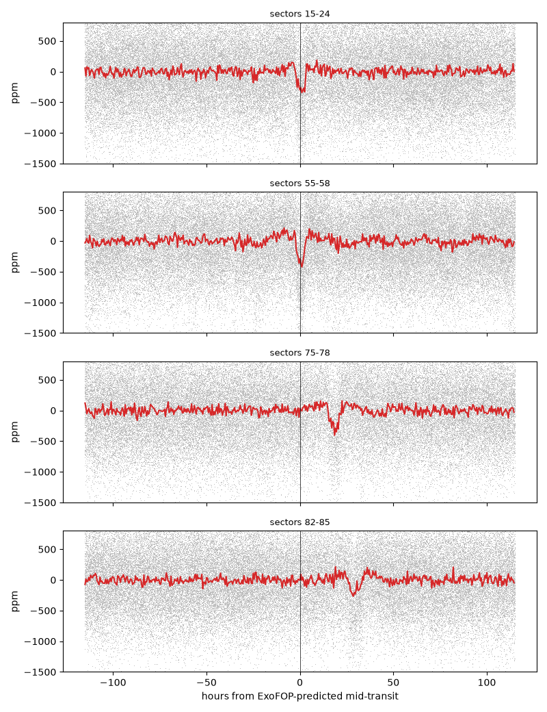

# Transit times of five TOIs, re-measured from TESS light curves

**Report checked:** a TOI-wide transit-timing (TTV) screening shared with the BAA EXPLORE group on 2026-11-24.
Its timings came from the LcTools TOI timing library. It listed TOI-1287.01, 475.01, 6973.01, 2556.01 and 2892.01
as notable unpublished TTV signals.

**Checked 2026-11-24.** Every time here is measured directly from the TESS light curves, without the timing library.

## Method

[`ttv_remeasure.py`](ttv_remeasure.py) does the following:

- **Light curves:** one per sector, through lightkurve. It prefers SPOC 120 s, then TESS-SPOC, then QLP. It uses
  the PDCSAP or KSPSAP flux with the default quality mask, and times in BTJD.
- **Transit shape:** a symmetric trapezoid with the ExoFOP duration (T14) and an ingress of 15% of T14, the same
  for every transit. Only the mid-time, the depth and a local cubic baseline are fitted.
- **Search:** a matched-filter scan over the **whole orbit** around each predicted time, in 2-minute steps. This
  finds a transit wherever it is, not just near the prediction.
  - At each trial time, the data within ±(1.5 T14 + 2.4 h) are fitted with and without the transit.
  - The detection statistic is Δχ² = χ²(baseline only) − χ²(baseline + transit).
- **Per sector:** the Δχ² scans of every transit in a sector are summed for one common offset. This is close to
  what the timing library provides.
- **Errors:** the 1σ error is where Δχ² falls by 1 from its peak.
- **Visual check:** [`fold_check.py`](fold_check.py) folds groups of sectors at the ExoFOP ephemeris.

Ephemerides are from the ExoFOP TOI table, downloaded 2026-11-24. Files for each TOI:

| File | Contents |
|---|---|
| `TOI*_sectors.csv` | per-sector O−C against the ExoFOP prediction (`o_c_min`), its error, Δχ² at the best offset (`dchi2`) and within ±1 h of the prediction (`dchi2_pred`) |
| `TOI*_transits.csv` | the same for single transits |
| `TOI*_oc.png` | O−C plots |

## Results

O−C is per sector, relative to the ExoFOP prediction. "Residual" is the half peak-to-peak O−C after refitting a
straight-line ephemeris to the per-sector times. "Report" is the amplitude given in the screening.

| TOI | What the light curves show | Residual | Report |
|---|---|---|---|
| 1287.01 | On time (within ±1.3 h) in S15–58 (2019–22). In S75–85 (2024–25) there is no dip at the predicted time: Δχ² 0–5, against 60–250 per sector before. A dip of the same depth is 17 h late in S75, and moves steadily to 30 h late by S84 (about 0.5 h per orbit). | ±10–15 h | 10.4 h |
| 475.01 | On time in S5–6 and S32–33, then 32–36 h early in S87–108. | ±5.7 h | 6.1 h |
| 6973.01 | On time in S17–58, then 14–15 h early in S84–85. | ±4.7 h | 4.9 h |
| 2556.01 | Deep transits (Δχ² > 1,000 per sector). The ExoFOP period is about 0.020 d too long (P ≈ 7.9949 d), so the predicted times drift by days. After a linear refit the residuals are ±3.8 h, the largest in S34 (+5.1 h). | ±3.8 h | 4.4 h |
| 2892.01 | QLP S4–37 about +1 h, SPOC S61–67 about −3.5 h, SPOC S87–97 about +2 h, after a linear refit. Part of this may come from the two pipelines (QLP 30 min against SPOC 2 min). | ±2.9 h | 3.0 h |

## What this does and doesn't show

- **The shifts are real:** the amplitudes in the report are reproduced without the timing library, so the timing
  shifts are in the light curves. The 2024–25 sectors make them obvious.
- **They are not shown to be planetary.**
  - TOI-1287 has a crowded field, a 0.1″ binary host and a centroid that varies between sectors. The abrupt change
    after S58 and the steady drift since would also fit a dip whose source or period is not what the ephemeris
    assumes.
  - Sector 48 of TOI-1287 also has a strong extra dip 102 h from the prediction, which is not explained here.
  - TOI-475 and 6973 each rest on three groups of sectors, so a steady period change cannot be told apart from a
    TTV.
- **Not done here:** per-sector centroids or depth maps for the late sectors, odd/even checks per group, and the
  S48 dip.
