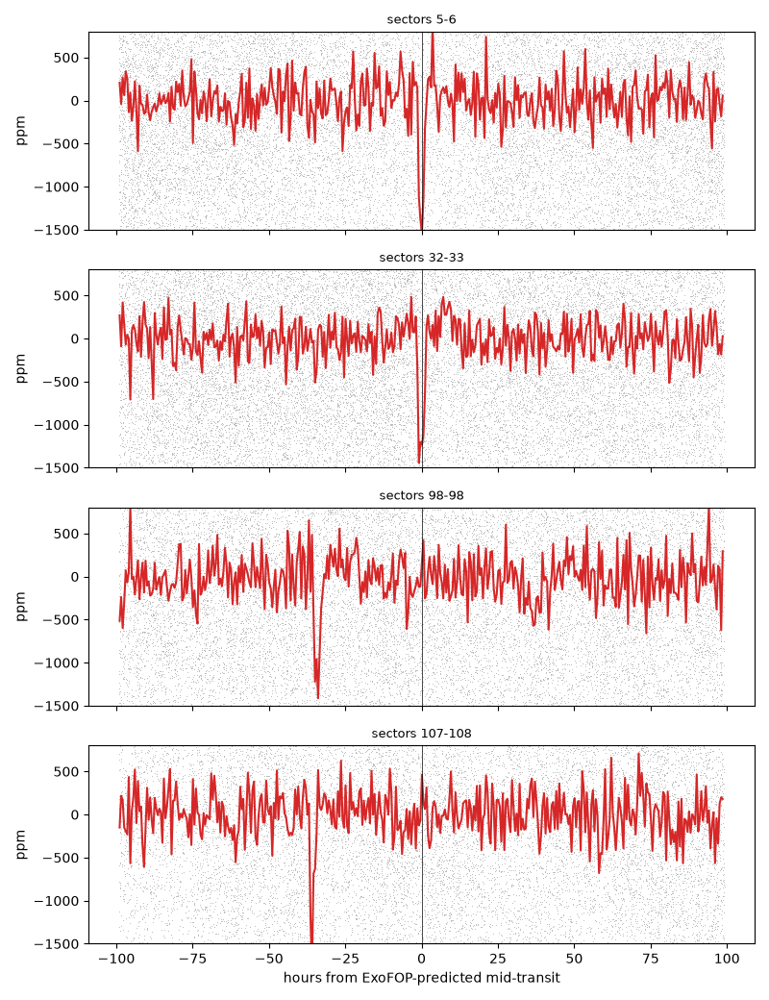
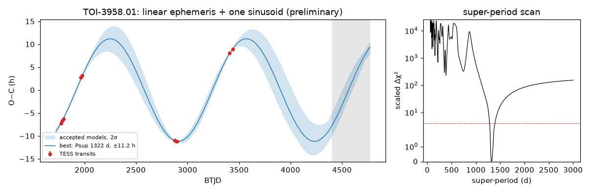

# Transit times of five TOIs, re-measured from TESS light curves

**Report checked:** a TOI-wide transit-timing (TTV) screening shared with the BAA EXPLORE group on 2026-11-24.
Its timings came from the LcTools TOI timing library. It listed TOI-1287.01, 475.01, 6973.01, 2556.01 and 2892.01
as notable unpublished TTV signals.

**Checked 2026-11-24.** Every time here is measured directly from the TESS light curves, without the timing library.

## Method

[`ttv_remeasure.py`](ttv_remeasure.py) does the following:

- **Light curves:** one per sector, through lightkurve. It prefers SPOC 120 s, then TESS-SPOC, then QLP. It uses
  the PDCSAP or KSPSAP flux with the default quality mask, and times in BTJD.
- **Transit shape:** a symmetric trapezoid with the ExoFOP duration (T14) and an ingress of 15% of T14, the same
  for every transit. Only the mid-time, the depth and a local cubic baseline are fitted.
- **Search:** a matched-filter scan over the **whole orbit** around each predicted time, in 2-minute steps. This
  finds a transit wherever it is, not just near the prediction.
  - At each trial time, the data within ±(1.5 T14 + 2.4 h) are fitted with and without the transit.
  - The detection statistic is Δχ² = χ²(baseline only) − χ²(baseline + transit).
- **Per sector:** the Δχ² scans of every transit in a sector are summed for one common offset. This is close to
  what the timing library provides.
- **Errors:** the 1σ error is where Δχ² falls by 1 from its peak.
- **Visual check:** [`fold_check.py`](fold_check.py) folds groups of sectors at the ExoFOP ephemeris.

Ephemerides are from the ExoFOP TOI table, downloaded 2026-11-24. Files for each TOI:

| File | Contents |
|---|---|
| `TOI*_sectors.csv` | per-sector O−C against the ExoFOP prediction (`o_c_min`), its error, Δχ² at the best offset (`dchi2`) and within ±1 h of the prediction (`dchi2_pred`) |
| `TOI*_transits.csv` | the same for single transits |
| `TOI*_oc.png` | O−C plots |

## Results

O−C is per sector, relative to the ExoFOP prediction. "Residual" is the half peak-to-peak O−C after refitting a
straight-line ephemeris to the per-sector times. "Report" is the amplitude given in the screening.

| TOI | What the light curves show | Residual | Report |
|---|---|---|---|
| 1287.01 | On time (within ±1.3 h) in S15–58 (2019–22). In S75–85 (2024–25) there is no dip at the predicted time: Δχ² 0–5, against 60–250 per sector before. A dip of the same depth is 17 h late in S75, and moves steadily to 30 h late by S84 (about 0.5 h per orbit). | ±10–15 h | 10.4 h |
| 475.01 | On time in S5–6 and S32–33, then 32–36 h early in S87–108. | ±5.7 h | 6.1 h |
| 6973.01 | On time in S17–58, then 14–15 h early in S84–85. | ±4.7 h | 4.9 h |
| 2556.01 | Deep transits (Δχ² > 1,000 per sector). The ExoFOP period is about 0.020 d too long (P ≈ 7.9949 d), so the predicted times drift by days. After a linear refit the residuals are ±3.8 h, the largest in S34 (+5.1 h). | ±3.8 h | 4.4 h |
| 2892.01 | QLP S4–37 about +1 h, SPOC S61–67 about −3.5 h, SPOC S87–97 about +2 h, after a linear refit. Part of this may come from the two pipelines (QLP 30 min against SPOC 2 min). | ±2.9 h | 3.0 h |

## What this does and doesn't show

- **The shifts are real:** the amplitudes in the report are reproduced without the timing library, so the timing
  shifts are in the light curves. The 2024–25 sectors make them obvious.
- **They are not shown to be planetary.**
  - TOI-1287 has a crowded field, a 0.1″ binary host and a centroid that varies between sectors. The abrupt change
    after S58 and the steady drift since would also fit a dip whose source or period is not what the ephemeris
    assumes.
  - Sector 48 of TOI-1287 also has a strong extra dip 102 h from the prediction, which is not explained here.
  - TOI-475 and 6973 each rest on three groups of sectors, so a steady period change cannot be told apart from a
    TTV.
- **Not done here:** per-sector centroids or depth maps for the late sectors, odd/even checks per group, and the
  S48 dip.

---

## Extended report (25 November 2026): the observable deep targets

**Checked 2026-11-25.** The second version of the report adds the targets observable from the north (Dec > +5°)
and south (Dec < −5°) with transits at least 4 ppt deep (its Tables 2a and 3a). All 15 not checked above were
re-measured the same way, with ExoFOP ephemerides downloaded on 2026-11-25. Results are in [`extended/`](extended/).

**Keeping only the TOI's own transits** ([`ttv_robust.py`](ttv_robust.py)). The whole-orbit scan takes the strongest
dip in each window. In a multi-planet system, or where systematics are strong, a window that holds no transit of
this planet locks onto another dip, hundreds of hours from the prediction. So a transit is kept only if its depth
is 0.5-2 times the ExoFOP depth and it lies within 24 h of the prediction, wider than every published TTV here except
TOI-4504's. For TOI-4504 and TOI-2525.01 the 24 h limit is replaced by removing single outliers (see the note in the
table). A straight-line ephemeris is then refitted, and **A** is half the peak-to-peak range of the per-sector mean O−C.

| TOI | Status | A here | A in report | Notes |
|---|---|---|---|---|
| 216.01 | published | 7.6 h | 7.2 h | Smooth swing from −8 to +7 h across 25 sectors |
| 4504.01 | published | 53 h | 51.5 h | No 24 h limit; 12 sectors |
| 2525.01 | published | 8.4 h | 7.0 h | Most windows lock onto the deeper .02, so depth filter plus outlier removal, no 24 h limit; 24 transits |
| 2525.02 | published | 1.3 h | 73 min | |
| 2202.01 | published | 1.5 h | 99 min | |
| 4562.01 | published | 34 min | 42 min | 6 transits |
| 7510.02 | confirmed | 38 min | 86 min | Only 3 sectors left after removing the other planets' dips |
| 3958.01 | candidate | 9.6 h | 9.4 h | Consecutive sectors agree within 1 h, and four groups move between −7.5 and +11.5 h: a real timing signal in the light curves ([plot](extended/TOI3958.01_robust_oc.png)) |
| 2361.01 | candidate | – | 5.5 h | **Period:** the transits fit P = 8.733152 d (rms 1.2 h), not ExoFOP's 8.71546 d or the report's 8.842 d; no clear TTV at that period ([details](extended/TOI2361_period.md)) |
| 6293.01 | candidate | 22 min | 2.4 h | Only 3 sectors kept; both S85 transits sit 11 h late against ExoFOP's ephemeris, which a 3-sector refit absorbs, so not settled |
| 3850.01 | candidate | 53 min | 53 min | |
| 7125.01 | candidate | 1.1 h | 62 min | 4 transits, all QLP |
| 7026.01 | candidate | 38 min | 42 min | |
| 4053.01 | FP (NEB) | 37 min | 67 min | |
| 590.01 | EB | 11 min | 38 min | 3 sectors |

**In short:** the published amplitudes are reproduced, which supports both the screening and this check. Among the
unpublished targets, TOI-3958.01's ~±10 h signal is clearly in the light curves. TOI-2361.01's "TTV" is a period
error. TOI-6293.01 needs more sectors.

### TOI-3958.01: a preliminary TTV-cycle model (added 2026-11-25)

Siegfried asked whether a preliminary model of the TTV cycle could be fitted. [`ttv_sine.py`](ttv_sine.py) fits a
linear ephemeris plus one sinusoid to the 10 kept transit times (sectors 17, 18, 24, 57, 58, 77 and 78, spanning
1,670 d), scanning the super-period from 60 to 3,000 d. The timing errors are scaled by ×1.97, so the best fit has a
reduced χ² of 1.

| | |
|---|---|
| Best super-period | 1,322 d (3.6 yr); accepted range 1,281–1,391 d (scaled Δχ² < 4) |
| TTV amplitude | ±11.2 h (11.1–11.2 h over the accepted range) |
| Mean period, T0 | 12.006054 d, 2864.52994 BTJD |
| χ² | 23.3 for 6 dof, against 104,607 for a straight line (8 dof) |
| Shorter super-periods | none fits anywhere in 60–1,200 d |

**Predicted transits in 2027** ([all 30](extended/TOI3958.01_sine_predictions.csv)). Over the year the model moves
from 7 h early to 9 h late against the mean ephemeris. A sample (BTJD = BJD_TDB − 2457000):

| Epoch | Linear ephemeris (BTJD) | Model (BTJD) | Model − linear | Date (UTC) | 2σ window |
|---|---|---|---|---|---|
| 129 | 4413.311 | 4413.005 | −7.3 h | 2027-01-07 12:07 | 5.1 h |
| 134 | 4473.341 | 4473.147 | −4.7 h | 2027-03-08 15:31 | 5.3 h |
| 139 | 4533.372 | 4533.304 | −1.6 h | 2027-05-07 19:17 | 5.1 h |
| 144 | 4593.402 | 4593.468 | +1.6 h | 2027-07-06 23:13 | 4.9 h |
| 149 | 4653.432 | 4653.625 | +4.6 h | 2027-09-05 03:00 | 4.0 h |
| 154 | 4713.462 | 4713.767 | +7.3 h | 2027-11-04 06:24 | 2.4 h |

**Caveats.** The data cover about 1.3 cycles in four groups of sectors, and a single sinusoid is the simplest shape a
TTV can take. The windows hold only if that shape is right, so they are a lower limit on the true uncertainty.
Anyone observing should allow several hours either side. Even one well-timed transit in 2027 would test the model
strongly, because it would land where the curve is steepest.

Run: `python ttv_sine.py extended/TOI3958.01_transits.csv 5497` (5497 ppm is the reference depth used by
`ttv_robust.py`).
