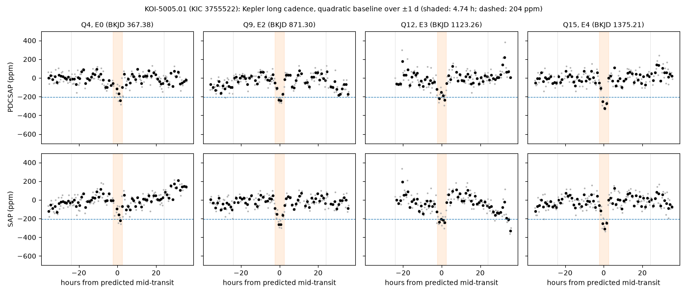
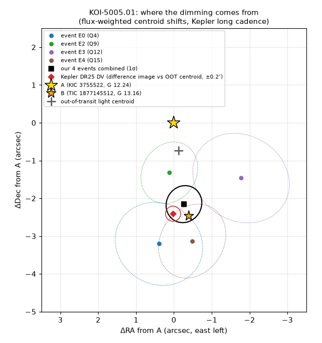

# KOI-5005.01 (KIC 3755522): check of a community report

**Report:** [Planet Hunters TESS Talk, 2026-10-30](https://www.zooniverse.org/projects/nora-dot-eisner/planet-hunters-tess/talk/2110/4167529)
(rabtsevich): Kepler P = 251.96 d, ~200 ppm, four dips; a false positive in the NASA Exoplanet Archive because the
dimming is offset from the target (DR25 comment `CENT_UNRESOLVED_OFFSET`). The reporter suggests the signal is on the
2.4″ companion, B. Questions: is it real, and is it on B?

**Checked 2026-10-30**, from Kepler long-cadence light curves (Q1–Q17, 15 quarters on MAST). KESTREL handles only
TESS data, so these are one-off checks with the scripts in this folder, not pipeline results.

**The two stars (Gaia DR3).** A = KIC 3755522 = TIC 138303937 (G 12.24, BP−RP 0.81, parallax 2.941 ± 0.011 mas,
RUWE 1.05). B = TIC 1877145512 (G 13.16, BP−RP 0.97, parallax 2.935 ± 0.015 mas, RUWE 1.38), 2.36″ south of A
with the same proper motion: a bound pair, ~800 au projected. B gives ~30% of the light.

**The four events** (P = 251.958533 d, T0 = BKJD 367.3803 from DR25; the fifth predicted time, BKJD 619.34, is in a
data gap). Depth from a quadratic baseline over ±1 d and the central 80% of a 4.74 h transit:

| Event | Quarter | PDCSAP (ppm) | SAP (ppm) |
|---|---|---|---|
| E0, BKJD 367.38 | Q4 | 179 ± 25 | 160 ± 26 |
| E2, BKJD 871.30 | Q9 | 190 ± 20 | 209 ± 19 |
| E3, BKJD 1123.26 | Q12 | 201 ± 29 | 231 ± 33 |
| E4, BKJD 1375.21 | Q15 | 239 ± 23 | 230 ± 25 |
| weighted mean | | 202 ± 12 (χ² 3.6, 3 dof) | 206 ± 12 (χ² 4.7, 3 dof) |

- **Against random times** (`events.py`): moving each event to a random time in its own quarter, 2,000 times, the
  stacked depth has a scatter of 19 ppm (PDCSAP; 21 ppm SAP). The real stack is 10.9σ (10.0σ); none of the random
  stacks reaches it, and none (PDCSAP) or 3 of 2,000 (SAP) reaches the same depth upside down.
- **Anywhere in four years** (`single_windows.py`): 10,405 windows of the same length, one every 0.1 d through all
  15 quarters away from the events, have a scatter of 38 ppm. Only 3 dip by ≥ 150 ppm and 2 by ≥ 179 ppm (the
  shallowest event), so a blind search can't build a chain of four comparable dips from noise in these data. The
  other side is heavier: 36 windows *brighten* by ≥ 150 ppm, so in the upside-down light curve "dips" this strong are
  common. That asymmetry may explain an inversion test finding comparable signals in the inverted data.

**Where the dimming comes from** (`centroids.py`). Per-event flux-weighted centroid shifts (MOM_CENTR columns),
converted to sky offsets with each quarter's pixel WCS (three different spacecraft orientations), divided by the
depth to give the source position relative to the out-of-transit light centroid. In all four events the light
centroid moves north, away from B. Along the A→B direction, A predicts −0.75″ and B +1.74″; the events give +2.36 ±
1.1, +0.54 ± 0.8, +0.98 ± 1.2 and +2.42 ± 1.0″. Combined: χ² 20.1 for A, 0.5 for B (2 dof). This agrees with
Kepler's DR25 difference-image result (source 1.68 ± 0.20″ from the out-of-transit centroid, near B). Flux-weighted
centroids from a pipeline aperture are only approximate (their scale depends on the aperture), but the direction alone
favours B in every event.

**If on B.** B's share of the light (~30%) makes the dip ~680 ppm on B: ~2.2 R⊕ with the TIC radius 0.78 R☉
(T_eff 5440 K, 0.95 M☉). A central transit of B on a 252 d orbit would last up to ~9.3 h, so 4.74 h needs an impact
parameter around 0.86 (or an eccentric orbit): possible, not a problem.

**Not checked here.** Whether B itself is an eclipsing binary or hosts one (no secondary search; only four events), and
ExoMiner. TESS can't add much: in its 21″ pixels A and B blend to the same ~200 ppm dip, below single-transit noise at
T ≈ 11.8, and a 252 d period leaves most sectors without a transit.

Scripts download the Kepler data from MAST into `kepler/` and write the figures here.
