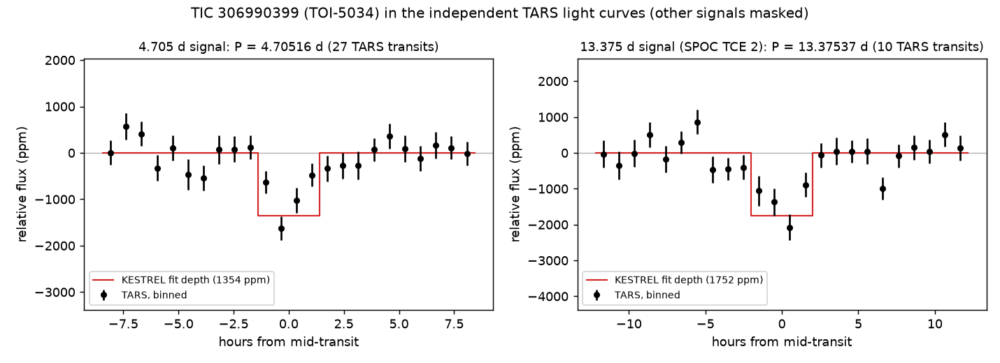

# TIC 306990399 (TOI-5034): check of a community report

**Report:** [Planet Hunters TESS Talk, 2026-10-28](https://www.zooniverse.org/projects/nora-dot-eisner/planet-hunters-tess/talk/2110/4165442)
(HakimG): a second signal on TOI-5034 at P = 4.70527 d, ~1.2 ppt, inside the orbit of TOI-5034.01 (8.704 d).

**Checked 2026-10-30.**

- **Blind search.** KESTREL (development v2 settings), given no period, on SPOC 2-minute (S66, S93, S100–S103) and
  TESS-SPOC FFI (S12, S13, S39) light curves, found three signals in turn: 8.70397 d (TOI-5034.01; 1946 ppm, SNR 21.9),
  **13.37536 d** (1756 ppm, SNR 18.8, 14 of 14 transits, odd/even 0.6σ; passes every automatic vetting test) and
  4.70520 d (1191 ppm, SNR 13.7; flagged only because S102 shows almost no dip).
- **The 13.375 d signal** is SPOC's TCE 2 from the sectors 1–96 multi-sector run (13.375267 d, 1927 ppm), not
  promoted to a TOI (ExoFOP lists TOI-5034.01 only, no CTOIs). Global fit: P = 13.37537 ± 0.00003 d, depth
  1752 ± 95 ppm, T14 4.05 h. 13 of 18 transits are detected singly, on time to within −16 to +12 min. TARS:
  1971 ± 183 ppm over 10 transits, 8.8σ against stacks at 40 random phases. SPOC centroid: −1.0 ± 2.0, −2.6 ± 2.1 mas
  (leaving out three events with 170–420 mas jumps in S102 and S103), on the target. Depth map (TESScut, 8 sectors
  without S102): on the target; the nearest alternative, TIC 1510357983 (T 17.5, 12.7″), is worse by Δχ² 80.
  Its period is 1.537 times that of TOI-5034.01, near 3:2.
- **The 4.705 d signal.** Global fit P = 4.70516 ± 0.00001 d (fits all nine sectors 2019–2026), depth 1354 ± 121 ppm,
  T14 2.8 h. TARS: 1125 ± 128 ppm over 29 transits, 7.5σ against random phases. SPOC 2-minute data alone (28
  transits, the other two signals masked): in-transit −886 ± 81 ppm, 6.6σ against random phases. Centroid
  −2.4 ± 1.3, −2.5 ± 1.3 mas; every neighbour T ≤ 14.7 within 2′ excluded at ≥ 26σ. Too shallow for the depth map.
- **The drop before the dip.** In the hour before ingress: −300 ± 120 ppm (1.9σ against random phases) with
  T14 = 2.2 h, −186 ± 120 ppm (1.2σ) with our fitted 2.64 h; the hour after egress +100 ± 119 ppm. Not significant;
  most of it is ingress if the transit is as long as our fit.
- **Sector 102** is troubled for both signals (the 4.705 d dip is weak there, and the 13.375 d transits show large
  centroid jumps that pull the depth map towards a faint star when S102 is included).
