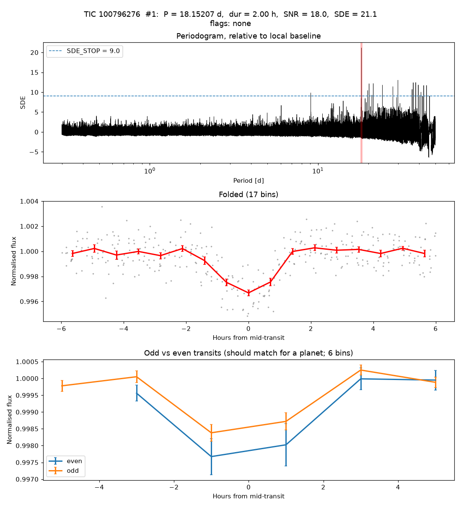

# TIC 100796276: independent recovery of a community candidate

**Report:** [Planet Hunters TESS Talk, 2026-10-19](https://www.zooniverse.org/projects/nora-dot-eisner/planet-hunters-tess/talk/2110/4158970)
(rabtsevich): P = 18.15219 ± 0.00003 d, T0 = BTJD 2036.976 ± 0.002, ~3.6 ppt, ~2.4 h on an M dwarf at ~43 pc; six
transits 2020–2026; SPOC's Sector 27 TCE was at 11.47 d.

**KESTREL search, 2026-10-20.** The star is outside our survey (TESS magnitude 11.69, Teff 3,491 K), so it was searched on
its own with the frozen survey code (paper-v1), without being given the period. Data: SPOC 2-min Sector 27, TESS-SPOC
Sector 67, QLP Sectors 94 and 104.

| | Report | KESTREL |
|---|---|---|
| Period (d) | 18.15219 ± 0.00003 | 18.15207 |
| Mid-transit (BTJD) | 2036.976 ± 0.002 | 2036.982 |
| Depth | ~3.6 ppt | 2.7 ppt (2 h box) |
| Detection | | SNR 18.0, SDE 21.1, strongest signal, clean (no vetting flags) |

The 18.15 d period is the strongest peak in KESTREL's search, and it passes all of KESTREL's automatic vetting. The small
differences in period and epoch are within our search grid's resolution; the shallower depth comes from our 2-hour
box (the transit lasts ~2.4 h) and from QLP's Sector 104 light curve, which shows that transit at about half depth.
