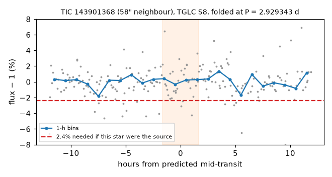
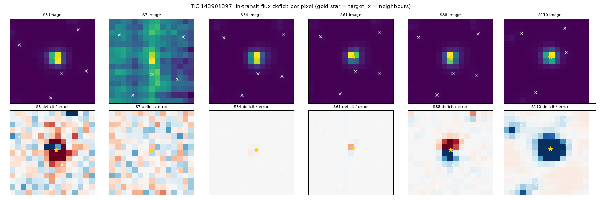

# TIC 143901397: is the 58″ neighbour the source?

**Report:** [Planet Hunters TESS Talk, 2026-11-17](https://www.zooniverse.org/projects/nora-dot-eisner/planet-hunters-tess/talk/2110/4183497)
(eldee). A 173 ppm, 3.3 h dip every 2.929343 d on a T = 8.24 star, about 1.95 R⊕ if it's on the target. The open
question is the neighbour TIC 143901368 (58.6″, G = 14.0, Gaia RUWE 17), which would need an eclipse of about 2.4%.

**Checked 2026-11-25** at the reported ephemeris (P = 2.929343 d, T0 = BTJD 2984.7636, T14 = 3.3 h).

## 1. The neighbour's own light curve

- **Data:** only one light curve of the neighbour exists, TGLC S8 (30 min). Its PSF flux is empty for this star,
  so the calibrated aperture flux is used. TGLC subtracts its model of the nearby stars, the bright target
  included, before summing the aperture.
- **Cleaning:** quality flags applied, 1-day running median removed, and 129 of 838 points beyond 5 × MAD clipped
  (target residuals). The robust scatter is 2.0% per point.
- **Result:** across 5 transits (26 in-transit points), the mean in-transit drop is 0.29 ± 0.55%. The same
  measurement at 300 random phases scatters by 0.58%. **A 2.4% eclipse is excluded at 3.8σ in S8.**

## 2. Depth map (KESTREL `depth_map.py`)

- **Method:** for each sector, every star within 2.5′ and up to 5.5 mag fainter than the target is tried as the
  source of the in-transit flux deficit in the TESScut FFI cutout, with the neighbour always included. χ² is
  summed over sectors.
- **Sectors:** S7, S8, S34, S61, S88 and S110 (46 predicted transits). S7 has FFI data but no pipeline light curve.
- **Result:** the target is the best source overall, but the dip is barely located at this depth. The target
  beats "no dip anywhere" by Δχ² 9.0 and the neighbour by 5.4. Per sector the preference is weak either way
  (S8 favours the target by 3.5; S7 and S34 are even).
- So the FFI depth map **leans to the target but does not settle it** on its own.

## Summary

The neighbour's own photometry is the stronger test: it does not dim by the 2.4% a source there would need. Both
checks point the same way as the pixel-response fits posted by DagfinnExolab on the thread (2026-11-24).

**Not done here:** high-resolution imaging, a deeper look at the neighbour in ZTF, the 13.85 d and 19.94 d
residual signals.

Code: [`check.py`](check.py) (lightkurve, numpy, and KESTREL's `depth_map.py`). Numbers: [`result.json`](result.json).
