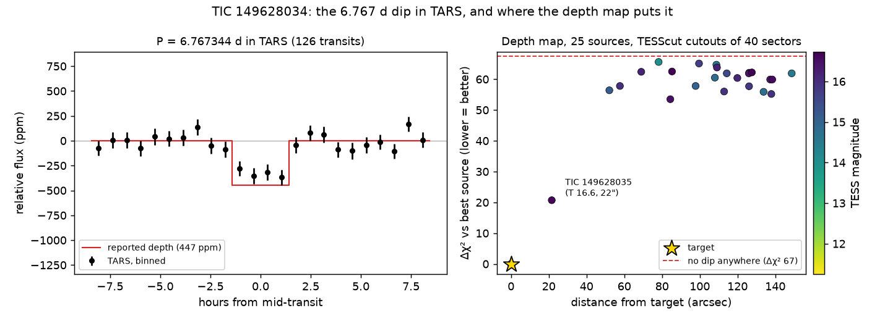

# TIC 149628034: check of a community report

**Report:** [Planet Hunters TESS Talk, 2026-10-28](https://www.zooniverse.org/projects/nora-dot-eisner/planet-hunters-tess/talk/2110/4165512)
(Alaa_Sr): P = 6.767344 d, T0 = BTJD 2148.3466, 2.81 h, 447 ppm, K7 dwarf (Tmag 11.25), southern continuous viewing zone.
Same period as the unpromoted SPOC TCE 149628034-01 (Sectors 1–13).

**Checked 2026-10-30.**

- **Transit fit.** In SPOC 2-minute (S2–S13), TESS-SPOC FFI (S1, S27–S69) and QLP (S87–S98) light curves, about 125
  transits: P = 6.76736 ± 0.00001 d, T0 = BTJD 2148.3459 ± 0.0018, depth 425 ± 27 ppm, T14 2.59 ± 0.17 h.
- **Independent light curves.** TARS 405 ± 36 ppm over 123 transits (9.0σ against 40 stacks at random phases, the
  largest random stack 93 ppm); GSFC-ELEANOR-LITE 456 ± 53 ppm (35 transits); TASOC 472 ± 69 ppm (28); TGLC
  376 ± 138 ppm (28).
- **Centroid (SPOC 2-minute data, 36 transits).** In-transit shift col −3.0 ± 1.4, row +4.1 ± 1.9 mas, 2.9σ from the
  target's prediction (two outlying events contribute). Every catalogued star T ≤ 15.5 within 2′ is excluded at
  7.7–21σ, and the nearest faint one, TIC 149628035 (T 16.6, 21.6″), at 7.0σ: it would move the centroid the opposite way.
- **Where the dip is.** A per-source depth map from TESScut cutouts of 40 sectors puts the dip on the target (Δχ² 67
  against no dip). The only star that comes near is TIC 149628035 (Δχ² 21 worse); every other catalogued neighbour
  within 2.5′ is ≥ 53 worse.
- **Open.** Anything unresolved within a few arcseconds of the target (Gaia DR3 has no source within 14″):
  high-resolution imaging.

`figure.py` makes the figure (TARS files from MAST, depth map summary in `depth_map.txt`).
