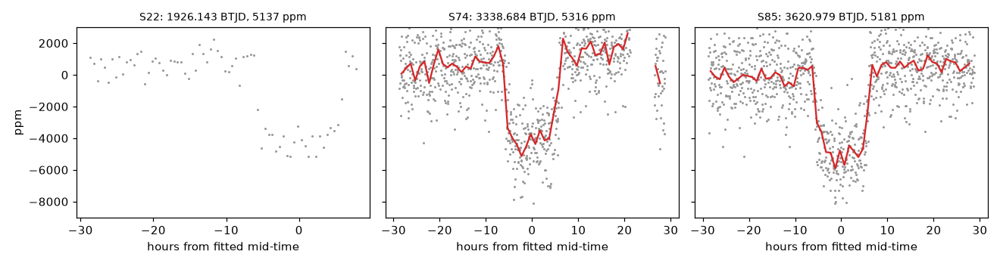

# TIC 233236594: check of a community report

**Report:** [Planet Hunters TESS Talk, 2026-11-23](https://www.zooniverse.org/projects/nora-dot-eisner/planet-hunters-tess/talk/2110/4188077)
(mkmyers45). Three transits of a Saturn-sized companion of a Sun-like star (S22, S74, S85). P ≈ 282.48 d, depth
~5,540 ppm, T14 ≈ 12.4 h, with TTVs of up to ±2.4 h.

**Checked 2026-11-24.**

- **Light curves:** one per sector from 33 sectors (S15–S86). SPOC 120 s was used where it exists, otherwise
  TESS-SPOC or QLP.
- **Transit times:** a fixed trapezoid (T14 12.41 h, ingress 0.91 h) with a local baseline was scanned over each
  event in 1-minute steps. The S22 transit ends about 2 h before the sector's last frame, so only a pre-transit
  baseline exists there; a linear baseline is used for it.

  | Sector | Mid-time (BTJD) | Depth (ppm) |
  |---|---|---|
  | 22 | 1926.143 | 5,137 ± 257 |
  | 74 | 3338.684 | 5,316 ± 184 |
  | 85 | 3620.979 | 5,181 ± 174 |

  The depths agree within their errors.
- **Period:** P = 282.451 d from the three times, with epochs 0, 5 and 6. Every shorter alias P/n (n = 2–80) is
  ruled out. Each one predicts transits in other sectors with data, and at those times a dip of the observed depth
  is excluded at 25–30σ, allowing ±3 h for TTVs. So the period is 282.45 d, with no other transits in the data.
- **TTVs:** the three times do not fit a constant period. Against the best straight-line ephemeris the O−C values
  are −4.1 h (S22), +2.7 h (S74) and −1.0 h (S85).
  - The fit's formal timing errors are a few minutes and are underestimates. Even allowing ±30 min for S22 (30-min
    cadence, at the sector edge), the deviation is far beyond the noise.
  - Put another way, the S74–S85 interval (282.295 d) is 0.18 d shorter than one fifth of the S22–S74 interval
    (282.508 d).
- **Caveats:**
  - Three times can only show that the period isn't constant. They can't give the TTV period or its cause.
  - The S22 time rests on 30-minute data at the end of a sector.
  - Gaia DR3 shows significant astrometric excess noise (16.9σ) despite RUWE 1.02. That may be worth a look for
    an unresolved companion.
- **Not done here:** depth map and centroid, and a full transit fit.

Code: [`check.py`](check.py) (lightkurve and numpy). Numbers: [`result.json`](result.json).
