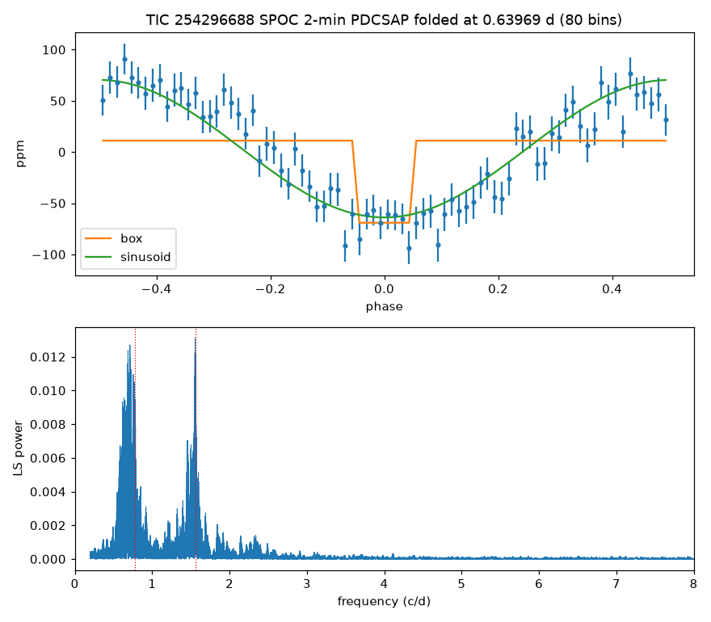

# TIC 254296688 (HD 222334): check of a community report

**Report:** [Planet Hunters TESS Talk, 2026-10-19](https://www.zooniverse.org/projects/nora-dot-eisner/planet-hunters-tess/talk/2110/4159237)
(RaymondSmith): P = 0.63969 d, ~1.7 h, ~90 ppm (consistent in PDCSAP, SAP, TESS-SPOC and QLP) on a T = 8.44 F2V star,
SPOC 2-minute sectors 2, 29, 69, 96, 106 and 107; no TOI, CTOI or SPOC TCE.

**Checked 2026-10-20** (SPOC 2-min PDCSAP, all six sectors, flattened with a 2.5 d window):

| Test | Result |
|---|---|
| Fold at 0.63969 d (80 bins): 1.7 h box | χ² = 656 |
| Same fold: sinusoid (67 ppm amplitude) | χ² = 118 |
| Same fold: flat line | χ² = 851 |
| Out-of-transit variation in phase with the dip | ~61 ppm |
| Lomb–Scargle periodogram | groups of peaks at 0.5–0.8 c/d and 1.4–1.6 c/d |

- The signal is a smooth wave over the whole period, not a box-shaped dip with a flat baseline.
- The periodogram shows the frequency groups typical of a γ Doradus pulsator (g modes), as expected for an F2V star;
  the 0.64 d signal sits in the higher group.
- This also explains why SPOC has no TCE: its search removes quasi-periodic stellar variability before looking for
  transits.

**Conclusion:** stellar pulsation, not a transit.
