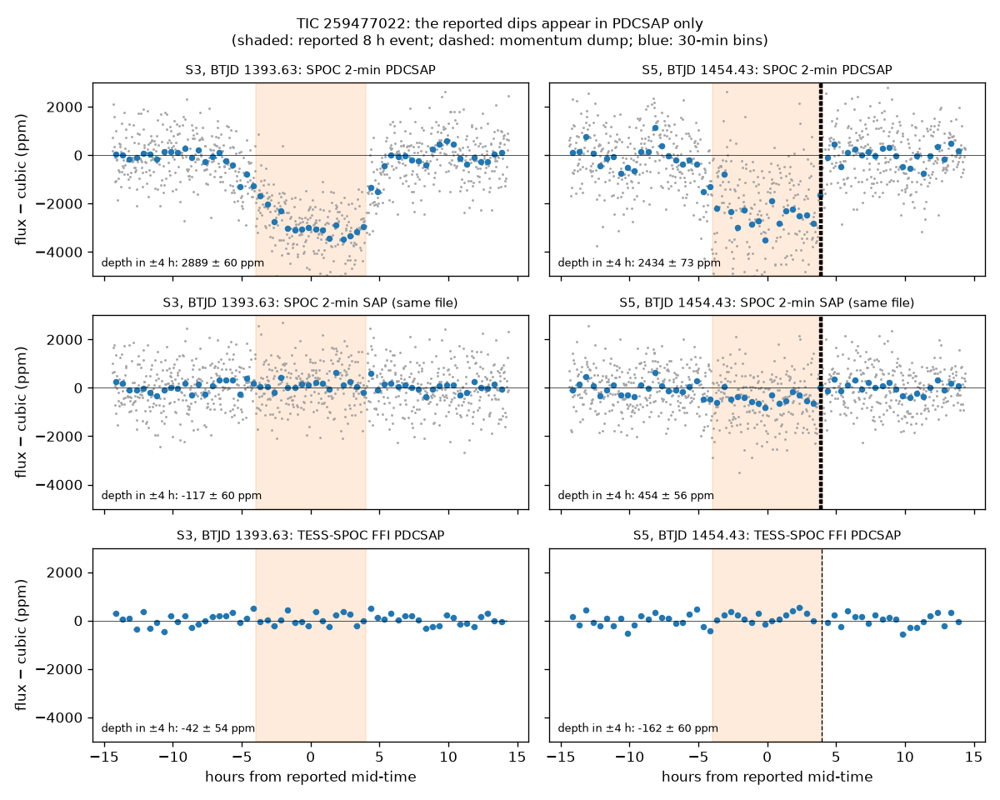

# TIC 259477022: check of a community report

**Report:** [Planet Hunters TESS Talk, 2026-10-17](https://www.zooniverse.org/projects/nora-dot-eisner/planet-hunters-tess/talk/2110/4157680)
(RaymondSmith): a BLS search of the SPOC 2-minute light curves found ~2300 ppm, ~8 h events at BTJD 1393.63 (Sector 3)
and 1454.43 (Sector 5), possibly 3035.10 (Sector 63), with P = 60.795 d or 30.398 d.

**Checked 2026-10-18.** Depth over ±4 h of each reported time, against a cubic fitted to the flux 6–14 h either side
(white-noise errors; out-of-transit 30-min bins wander by a few hundred ppm):

| Event | SPOC 2-min PDCSAP | SPOC 2-min SAP (same file) | TESS-SPOC FFI PDCSAP |
|---|---|---|---|
| S3, BTJD 1393.63 | 2889 ± 60 ppm | −117 ± 60 ppm | −42 ± 54 ppm |
| S5, BTJD 1454.43 | 2434 ± 73 ppm | 454 ± 56 ppm | −162 ± 60 ppm |

- The dips appear in the PDCSAP flux only: the raw (SAP) flux of the same files and an independent reduction of the
  same sectors (TESS-SPOC, from the full-frame images) show none.
- In Sector 5 the PDCSAP dip ends exactly at a momentum dump (quality flags 4, 32 and 128 at BTJD ≈ 1454.59).
- The star is spotted (VSX: Gaia DR3 rotational variable); its brightness varies by ~1% over a few days.
- Sector 63 (BTJD 3035.10): 273 ± 130 ppm in the 2-min PDCSAP flux; no clear dip.

**Conclusion:** the two events are most likely introduced by the PDC systematics correction, not transits.

`figure.py` makes the figure from the public MAST light curves (lightkurve; run from any folder, it writes
`pdcsap_vs_sap.png` next to itself).
