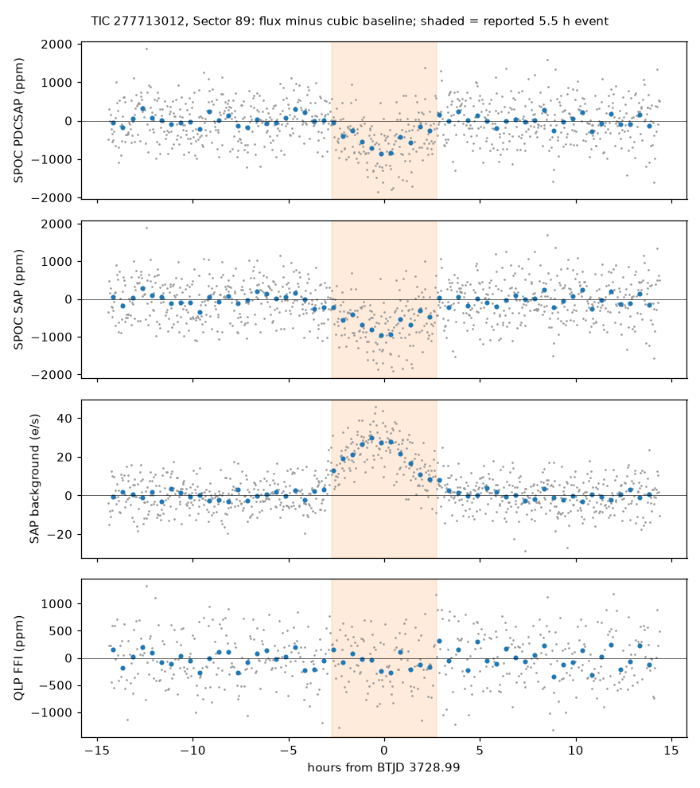

# TIC 277713012: check of a community report

**Report:** [Planet Hunters TESS Talk, 2026-10-19](https://www.zooniverse.org/projects/nora-dot-eisner/planet-hunters-tess/talk/2110/4158825)
(RaymondSmith): a single ~5.5 h event at BTJD 3728.99 (Sector 89; PDCSAP 440 ± 42 ppm, SAP 595 ± 42 ppm) and a
possible earlier event at BTJD 1535.24 (Sector 8), just after a data restart.

**Checked 2026-10-19.** Offsets over ±2 h of each time, against a cubic fitted to the data more than 4.7 h away
(white-noise errors):

| Sector 89, BTJD 3728.99 | Offset |
|---|---|
| SPOC 2-min PDCSAP | −547 ± 48 ppm |
| SPOC 2-min SAP | −666 ± 49 ppm (30 e⁻/s) |
| SPOC SAP background | **+23.0 ± 0.7 e⁻/s** |
| SPOC flux-weighted centroids | no shift (< 0.0002 px) |
| QLP FFI (200 s) | +85 ± 54 ppm |
| TARS FFI | −82 ± 149 ppm |

- The SAP background rises and falls in step with the dip, with the same shape and timing, and the rise (23 e⁻/s)
  is comparable with the dip (30 e⁻/s). Two independent reductions of the same sector (QLP, TARS) show no dip.
- This is what an over-subtracted background looks like during scattered light: the dip is most likely an artefact
  of the background correction, not a transit.
- Sector 8 (BTJD 1535.24): the event begins 5.8 h after the data resume; the centroids and pointing corrections shift
  during it (15–20σ) and SAP (−1412 ± 106 ppm) disagrees with PDCSAP (−273 ± 56 ppm): settling after the restart.

**Conclusion:** neither event is likely to be a transit.
