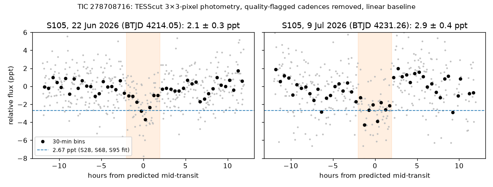
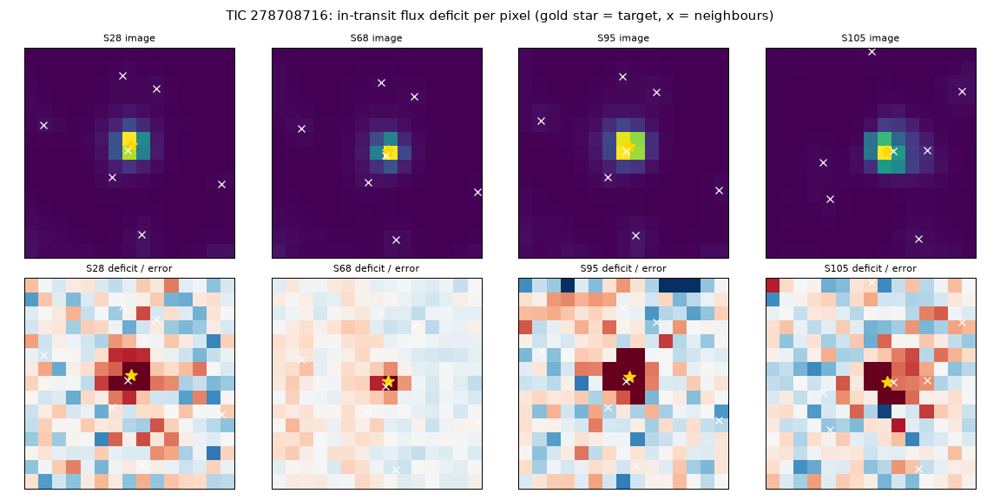

# TIC 278708716: check of a community report

**Report:** [Planet Hunters TESS Talk, 2026-10-30](https://www.zooniverse.org/projects/nora-dot-eisner/planet-hunters-tess/talk/2110/4167303)
(Mrsky): P = 17.21424 d, T0 = BTJD 3904.1943, ~2.5 ppt, ~4 h, K dwarf (Tmag 11.6); seven transits in S28, S68, S95
and S105. Question: is the 22 Jun 2026 (S105) transit, ~1.5 ppt in the reporter's light curve, a worry?

**Checked 2026-10-30.**

- **Transit fit.** In TESS-SPOC FFI (S28, S68) and QLP (S95) light curves, five transits: P = 17.21425 ± 0.00003 d,
  T0 = BTJD 3904.1942 ± 0.0024, depth 2672 ± 112 ppm, T14 4.00 ± 0.16 h. Each transit is detected on its own
  (Δχ² 81–139 against no transit) and within ±10 min of the linear ephemeris. The duration fits the star: a central
  transit of a 0.83 R☉, 0.85 M☉ star (TIC values) on a 17.2 d orbit lasts at most 4.3 h. ~4.7 R⊕ if on the target.
- **Independent light curves.** TARS: S28 2793 ± 355, S68 2960 ± 397, S95 3161 ± 383 ppm; stacked 2963 ± 218 ppm,
  10.5σ against 40 stacks at random phases (the largest random stack 645 ppm).
- **Sector 105.** Only TESScut cutouts are on MAST so far. Aperture photometry of a 15×15 cutout (quality-flagged
  cadences removed, background from the faintest 30% of pixels, linear baseline over ±12 h, depth from the central
  3 h, no crowding correction):

  | Aperture | 22 Jun 2026 (BTJD 4214.05) | 9 Jul 2026 (BTJD 4231.27) |
  |---|---|---|
  | 1 pixel | 2561 ± 511 ppm | 4233 ± 1152 ppm |
  | 3×3 | 2103 ± 262 ppm | 2934 ± 407 ppm |
  | 5×5 | 2402 ± 316 ppm | 2483 ± 367 ppm |
  | radius 3 px | 2426 ± 328 ppm | 2714 ± 385 ppm |

  The 22 Jun transit is 2.1–2.6 ppt here, within 2σ of the other sectors. The 9 Jul light curve is noisier
  (out-of-transit scatter 2.7 against 1.9 ppt in the 3×3 aperture). In Sector 106 the predicted transit
  (BTJD 4248.48) falls in a data gap.

  

- **Where the dip is.** A per-source depth map from TESScut cutouts of S28, S68, S95 and S105 puts the dip on the
  target in each sector (Δχ² 506 against no dip). The G ~16 neighbour at 55″ (TIC 278708723, T 15.8) is 502 worse,
  every other catalogued star within 2.5′ to T 17.1 at least 500 worse. The closest source, an extended TIC object
  at 8.7″ (TIC 10002581017, T 17.1), is 60 worse; the Gaia star there (T 18.7) is too faint to make a 2.7 ppt dip
  even if fully eclipsed.

  

- **Open.** Anything unresolved within a few arcseconds of the target: high-resolution imaging.

`s105_plot.py` makes the S105 figure from a TESScut cutout; `depth_map.txt` is the depth-map summary.
