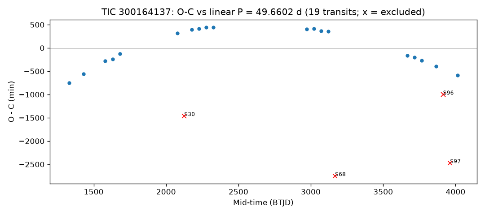
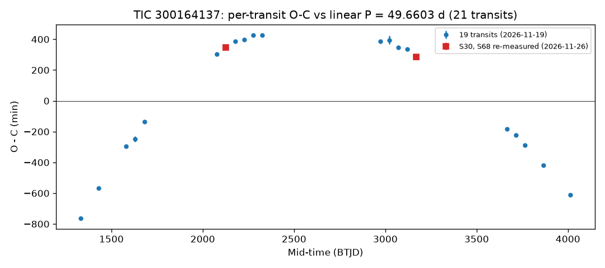
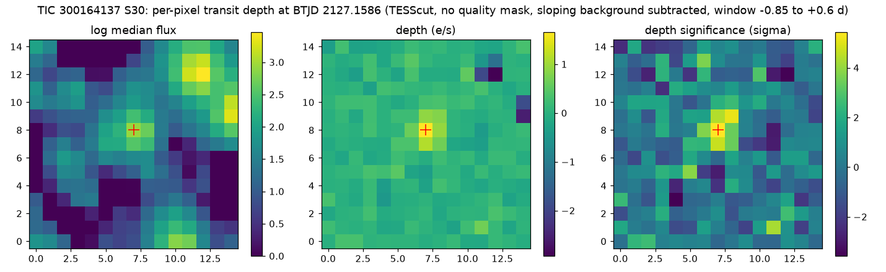

# TIC 300164137: transit timing check of a community report

**Report:** [Planet Hunters TESS Talk, 2026-11-18](https://www.zooniverse.org/projects/nora-dot-eisner/planet-hunters-tess/talk/2110/4185280)
(mkmyers45): ~2.2 ppt, 11.75 h transits every ~49.66 d on a T = 11.75 F subgiant (1.97 R☉), with possible TTVs. orionlee
noted strong TTVs and on-target dips.

**Checked 2026-11-19** with `ttv.py`: one fixed trapezoid shape (T14 11.75 h, ingress 0.55 h) fitted to each transit
separately, with a free mid-time, depth and local linear baseline. Mid-times come from a ±1.5 d scan; errors from Δχ² = 1,
scaled by the reduced χ² when above 1. The best light curve per sector (SPOC, then TESS-SPOC, then QLP). Results are in `ttv.json`.

| Result | |
|---|---|
| Transits timed | 19, S1 to S98 (2,682 d); errors 4–29 min. **21 with S30 and S68 since 2026-11-26** (below) |
| Left out | S96 (transit in the orbit gap) and S97 (systematics: reduced χ² 32). S30 and S68 were left out on 2026-11-19 by mistake (corrected below) |
| O−C against P = 49.66 d | smooth arch, −750 min (S1) → +440 min (S28–S66) → −590 min (S98): ~20 h peak to peak (figure) |
| Constant period | ruled out: χ² 82,893 for 17 dof (quadratic 708/16, cubic 40/15, rms ~13 min) |
| TTV super-period | > ~5,000 d; less than one cycle covered |
| Depths | steady, ~1.8–2.4 ppt |
| Light-travel time | can't explain ±10 h (would need a ~70 AU reflex orbit within the span: hundreds of M☉), so dynamical |
| QLP TCE period 264.121 d | 5.32 × 49.66 d, not an alias: the TTV threw off the period search |
| Next windows (O−C polynomials, degree 2–4; ±4 h at best) | BTJD ~4410.4 (2027-01-04), ~4460.0 (2027-02-23), ~4509.6 (2027-04-14); Dec −66°. Unchanged with 21 transits (cubic: 4410.48, 4460.09, 4509.69) |

## Update 2026-11-26: S30 and S68 re-measured

DagfinnExolab ([comment](https://www.zooniverse.org/projects/nora-dot-eisner/planet-hunters-tess/talk/2110/4185280?comment=6841162))
re-checked the three transits left out above and found S30 and S68 usable. Both were left out by mistake:
the ±1.5 d scan around a constant period locked onto a systematic two days before the S68 transit, and the S30 transit falls
in a gap in the TESS-SPOC light curve, where every cadence is flagged for scattered light.

`recheck.py` measures both again with the same transit shape, scanning ±0.6 d around a cubic fit to the 19 transits
(rms 12.6 min), in every available light curve with and without the quality mask (`recheck.json`):

| Sector | Light curve | Mid-time (BTJD) | From the cubic prediction | Depth | DagfinnExolab |
|---|---|---|---|---|---|
| S68 | QLP | 3169.9805 | +1.4 ± 7.2 min | 2,274 ppm | 3169.9788 ± 0.0051 |
| S30 | QLP | 2127.1586 | +7.2 ± 11.5 min | 3,577 ppm (inflated: see below) | 2127.1522 |

**S30 pixels** (`s30_pixels.py`): a TESScut 15×15 cutout without the quality mask. The scattered light reaches 5,700 e/s
with a strong gradient across the cutout, so a sloping background plane is fitted to the faintest 30% of pixels and removed
from each image, and the fit window (−0.85 to +0.6 d) ends before a scattered-light rise at +0.75 d. The light loss is
concentrated on the target: 1,913 ppm (5.4σ) in its brightest pixel and 2,692 ppm over the 3×3 around it, while the
background pixels stay flat (−0.01 ± 0.17 e/s). S30 is a transit on the target at the usual depth; the deeper QLP value
comes from the scattered light.

With 21 transits (`oc21.py`) nothing changes: the cubic gives χ² 41 for 17 dof (rms 12.1 min) and the 2027 windows move
by about 2 h, well inside their ±4 h spread. S96 stays out (its mid-time is in the orbit gap).

