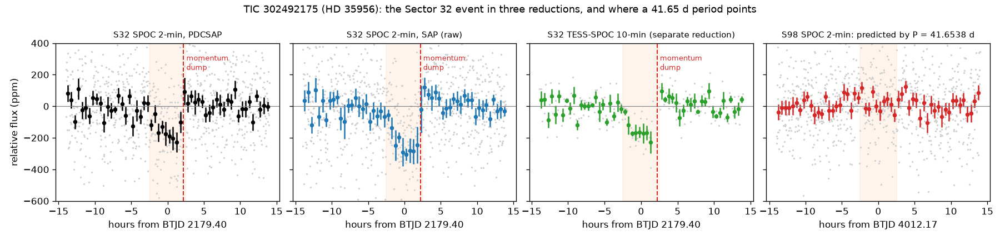

# TIC 302492175 (HD 35956): check of a community report

**Report:** [Planet Hunters TESS Talk, 2026-09-03](https://www.zooniverse.org/projects/nora-dot-eisner/planet-hunters-tess/talk/2110/4126968)
(erd12): an event in Sector 32, a BLS period of 41.6538 d, depth 0.5–1 ppt, duration 4.8–7 h.

**Checked 2026-10-21.**

- **The event is in the data:** at BTJD ≈ 2179.39, about 130–230 ppm over ~5 h, in SPOC PDCSAP, SPOC SAP and the
  separate TESS-SPOC reduction (~4σ against random times), with no change in the sky background.
- **It ends at a momentum dump** (BTJD 2179.491), where the flux steps straight back up in all three reductions. On a
  star this bright (T = 6.2, saturated) the flux in the aperture is sensitive to small pointing changes, so a drift
  that resets at the dump is the most likely cause.
- **No period:** one sector (~27 d) can hold only one transit at 41.65 d. The time the period predicts in Sector 98
  (BTJD 4012.17) is flat; Sector 6 shows +74 ppm (2.7σ); Sector 44's predicted time is in a gap. The other strong
  5-hour dips (Sectors 43, 71, 98) are absent from the raw SAP flux or sit at momentum dumps.

`figure.py` makes the figure from the light curves at MAST.
