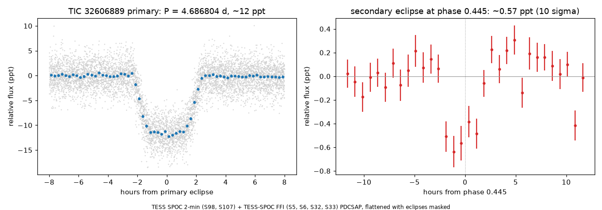

# TIC 32606889: check of a community report

**Report:** [Planet Hunters TESS Talk, 2026-11-07](https://www.zooniverse.org/projects/nora-dot-eisner/planet-hunters-tess/talk/2110/4174822)
(ST_StarTrace): deep, repeating dips in Sectors 5, 6, 32, 33, 98 and 107 of a Teff ~6530 K star (Tmag 11.6); not in
the Villanova TESS EB catalogue and not a TOI. Question: an uncatalogued eclipsing binary, or a hot Jupiter?

**Checked 2026-11-07.**

- **Light curves.** SPOC 2-min (S98, S107) and TESS-SPOC FFI (S5, S6, S32, S33) PDCSAP: a flat-bottomed eclipse every
  4.6868 d, about 4.2 h long and 12 ppt deep in every sector (11.8–12.2 ppt; 12.1–12.7 ppt in SAP flux). Odd and even
  eclipses have the same depth; the background flux (SAP_BKG) shows nothing at the eclipse times.
- **Already listed on ExoFOP.** It is a community TOI, TIC 32606889.01 (submitted 2020-08-10, "Montalto et al.
  (2020)", disposition PC; P = 4.68686 d, 10.9 ppt, 23.9 R⊕). The SPOC pipeline also found it in Sector 107 (TCE,
  P = 4.68611 d, MES 65). It has not been made a TOI.
- **Gaia DR3 radial-velocity orbit.** Gaia DR3's non-single-star table has a single-lined spectroscopic orbit (SB1)
  for this star (Gaia DR3 2915251318936591488): P = 4.68724 ± 0.00069 d, K = 20.3 ± 0.9 km/s, e = 0.14 ± 0.05. That
  is the eclipse period. For a 1.2–1.5 M☉ primary (TIC 1.35 M☉) seen nearly edge-on, as the eclipses require, the
  companion's mass is 0.20–0.23 M☉, a low-mass star (about 220 Jupiter masses). A 12 ppt eclipse of a 2.09 R☉ star
  needs a companion of about 0.23 R☉, which matches such an M dwarf.
- **Secondary eclipse.** Searching phases 0.2–0.8 with a 4 h box finds a 572 ± 56 ppm dip at phase 0.445 (10σ), in
  the FFI sectors (772 ± 56 ppm) and the 2-min sectors (500 ± 70 ppm) separately. Nothing at phase 0.5. The offset
  from 0.5 implies e cos ω ≈ −0.09, consistent with Gaia's eccentricity, and a ~3200 K M dwarf eclipsed by a 6530 K
  star would give about 600 ppm (blackbody estimate in the TESS band).

  

**Result:** an eclipsing binary, an F star with an M-dwarf companion of about 0.2 M☉. The Gaia orbit rules out a
planet, and the secondary eclipse agrees.

Script: `sec.py` (lightkurve; PDCSAP flattened with the eclipses masked).
