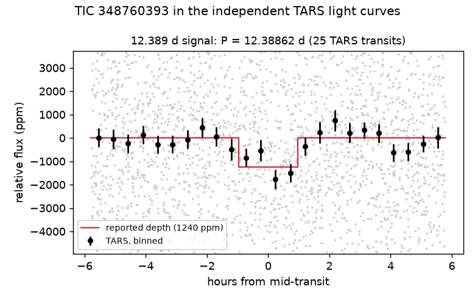
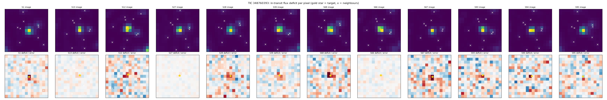

# TIC 348760393 (L 12-37): check of a community report

**Report:** [Planet Hunters TESS Talk, 2026-10-23](https://www.zooniverse.org/projects/nora-dot-eisner/planet-hunters-tess/talk/2110/4161335)
(RaymondSmith): P = 12.38862 d, T0 = BTJD 1325.8585, 1.93 h, 1240 ppm, M dwarf (R* 0.515 R☉, Tmag 12.4).

**Checked 2026-10-23.**

- **Our search.** In KESTREL's light curves (SPOC 2-minute S1, S12, S13; TESS-SPOC FFI S27–S68; QLP S93–S95) and
  detrending, the strongest first-pass periodogram peak is 12.38855 d at SDE 17.8 (next 11.4). At the reported
  ephemeris: 865 ± 118 ppm over 22 transits (~1.65 R⊕), odd/even 0.3σ, no secondary (77 ± 126 ppm), 7.1σ against
  2,000 stacks at random phases. SPOC sectors 750 ± 230 ppm vs TESS-SPOC FFI sectors 1062 ± 182 ppm: 1.1σ apart.
- **Independent light curves.** TARS 1217 ± 188 ppm over 25 transits (5.3σ against random phases); TASOC S1
  1349 ± 337 ppm (3.4σ); ELEANOR-LITE 974 ± 261 ppm (2.7σ); TGLC S1 1200 ± 507 ppm (2.1σ).
- **Where the dip is (added later on 2026-10-23).** A per-source depth map from TESScut cutouts of all 12 sectors puts
  the dip on the target: Δχ² 57–64 against every catalogued neighbour within 2.5′ (T ≤ 17.7) and 63.8 against no dip;
  8 of the 12 sectors favour the target on their own. The 14″ Gaia neighbour (G ≈ 19.7) is too faint for the TIC-based
  map and lies inside the TESS PSF, so it is not tested.

  

- **Transit by transit.** In our light curve the 22 transits agree with a single depth (984 ± 131 ppm; χ² 21.3 for
  21 degrees of freedom). KESTREL's own run on this star rejected the signal with its leave-a-quarter-out test (SNR
  5.5 without the 6 strongest events, 6.0 needed): a conservative test that removes upward noise along with the
  signal near threshold, not a sign that a few events dominate.
- **Open.** Imaging is still needed for the 14″ neighbour and anything closer; the reported NFPP (0.0023) is above the 0.001
  likely-planet limit of Giacalone et al. (2021), and RUWE is 1.25. High-resolution imaging is the next step.

`figure.py` makes the figure from the TARS files at MAST.
