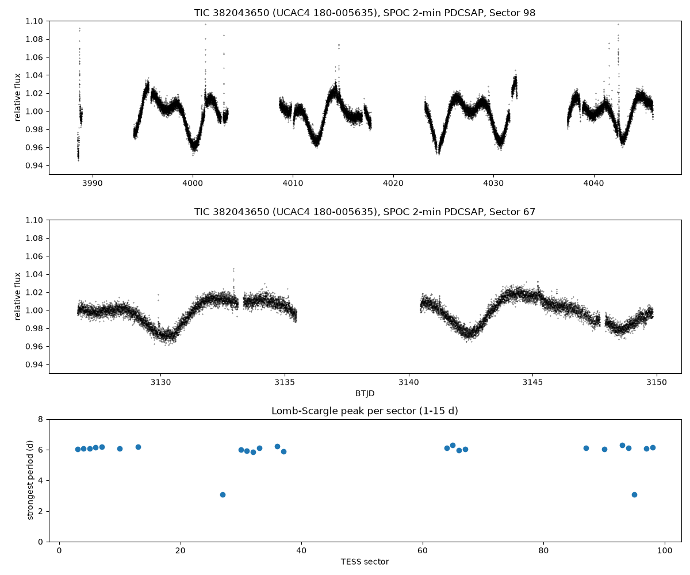

# TIC 382043650: check of a community report

**Report:** [Planet Hunters TESS Talk, 2026-11-07](https://www.zooniverse.org/projects/nora-dot-eisner/planet-hunters-tess/talk/2110/4174827)
(ST_StarTrace): a red dwarf (Teff ~3432 K, Tmag 11.96, more than 25 sectors) showing a sinusoidal wave with deep
dips, proposed as an uncatalogued W UMa contact binary. The post names TIC 382045026, a Tmag 18.5 star with no TESS
light curves; the subject and the quoted values are TIC 382043650 (UCAC4 180-005635), which is checked here.

**Checked 2026-11-07.**

- **Period.** SPOC 2-min PDCSAP light curves from 25 sectors (S3–S98). In 23 of them the strongest periodogram peak
  (1–15 d) is between 5.85 and 6.29 d (median 6.08 d). In S27 and S95 it is at half that, when the light curve has
  two minima per cycle. The variation is 33–71 ppt (5–95% range).
- **Shape.** The light curve changes from sector to sector: one broad minimum per cycle in S67, two unequal minima in
  S98. Eclipses repeat with the same shape at a fixed period; starspots on a rotating star change as they grow, decay
  and move. Contact (W UMa) binaries have periods under about a day.
- **No eclipses.** After removing the 6-day variation (8 h running trend) and the flares, a box search from 0.2 to 20 d
  finds nothing above the noise.
- **Flares.** Frequent flares in every sector, the largest in S98.
- **Catalogues.** SIMBAD lists UCAC4 180-005635 as an eruptive variable of spectral type M3. No VSX entry for the
  star, no TOI, CTOI or SPOC TCE.

  

**Result:** a spotted, flaring M dwarf rotating in about 6.1 days (a BY Draconis-type variable), not an eclipsing
binary.

Script: `fig.py` (lightkurve).
