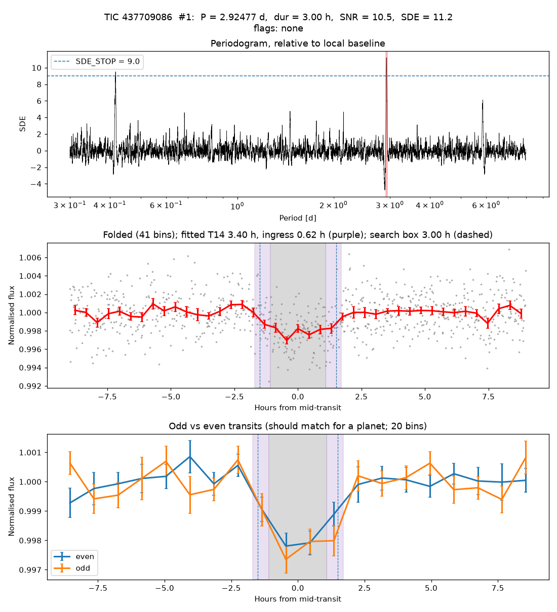
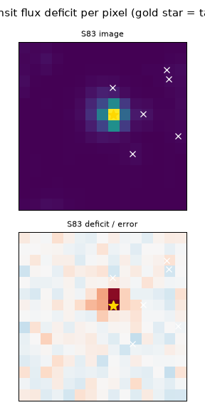

# TIC 437709086: check of a community report

**Report:** [Planet Hunters TESS Talk, 2026-11-20](https://www.zooniverse.org/projects/nora-dot-eisner/planet-hunters-tess/talk/2110/4186562)
(jtromero): P = 2.9252 d, ~2,000 ppm, ~3 h, Rp ~7–8 Earth radii, Sector 83 (the only sector with data).

**Checked 2026-11-21.**

- **Blind search.** Our search (KESTREL), run on the TESS-SPOC Sector 83 light curve without being given a period,
  finds the signal as its top peak: P = 2.92477 d, 2,074 ppm, 3.0 h, SNR 10.5, SDE 11.2, 8 transits, odd/even 0.8σ,
  no secondary (−87 ± 206 ppm). It passes all the search's checks.
- **Transit fit.** P = 2.9252 d, depth 1,970 (+310/−220) ppm, Rp/R★ = 0.044, b = 0.50 (0.18–0.82), T14 = 3.1 h,
  Rp ≈ 6.4 Earth radii. The stellar density from the fit, 0.64 (0.21–1.00) g/cm³, agrees with the TIC value
  (0.71 g/cm³) to 0.2σ.
- **Other reductions.** QLP (SAP and detrended) and TESS-SPOC SAP give the same depth on all 8 events
  (2,040–2,190 ± 210–250 ppm against 2,176 ppm in PDCSAP).
- **Background.** The SPOC sky background (about 0.7 of the star's flux in the aperture) is bumped up during two of
  the eight transits (BTJD 3562.2 and 3573.9). The dip is as deep in the transits without a bump, so the background
  does not make the signal.
- **Where the dip is.** A per-source depth map from TESScut cutouts puts the dip on the target, preferred by
  Δχ² ≈ 17 over each of the six catalogued neighbours within 2.5′ (T < 18.1; the nearest at 50″) and over no dip.
  From one sector this is about a 4σ preference.

- **False-positive probability.** TRICERATOPS (10 runs of 10⁶ draws, with the 34 stars nearby): FPP 0.059 ± 0.003,
  NFPP < 0.0001.
- **Catalogues.** Not a TOI or CTOI on ExoFOP; no match in the Villanova TESS EB catalogue, VSX or the Gaia DR3 EB list.
  TESS has no other sector of this star planned up to Sector 110.

The planet would be ~6–8 Earth radii on a 2.9 d orbit round a 6,170 K star, at the edge of the hot-Neptune desert,
where false positives are common, so it needs a second sector or ground photometry to confirm.
