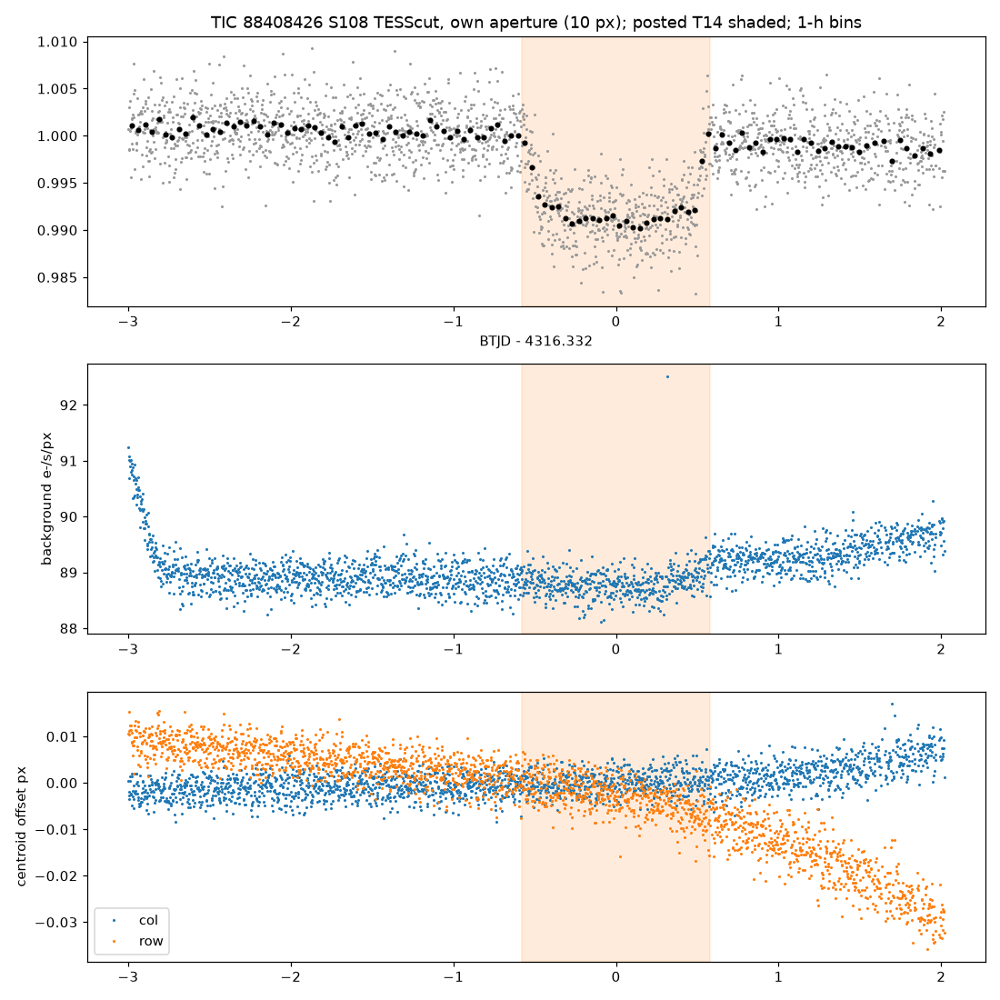
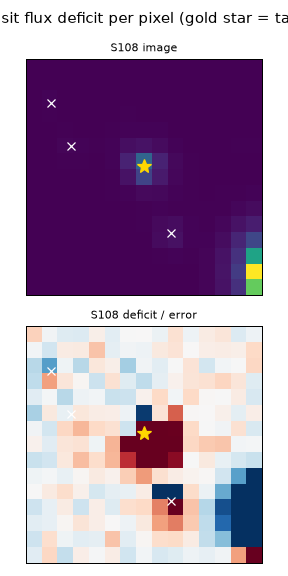
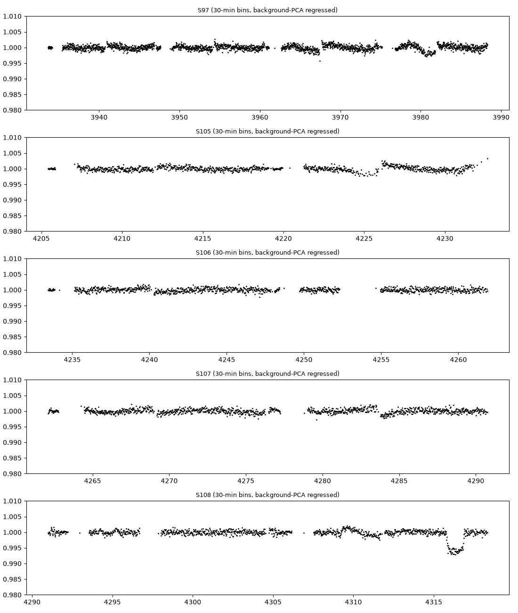

# TIC 88408426: check of a community report

**Report:** [Planet Hunters TESS Talk, 2026-11-11](https://www.zooniverse.org/projects/nora-dot-eisner/planet-hunters-tess/talk/2110/4178908)
(mkmyers45): a single ~27.7 h, ~9,200 ppm transit at BTJD 4316.332 (Sector 108, TESScut) on a T = 12.17 F9/G0 dwarf
(TIC: 6011 K, 1.27 R☉, 1.11 M☉); a circular-orbit period of about 1,616 d from the transit shape and the TIC density.

**Checked 2026-11-12** with TESScut cutouts of all seven sectors (4, 31, 97, 105–108), our own apertures and
background, independent of the posted analysis.

| Test | Result |
|---|---|
| Depth (core, local linear baseline), 10-px aperture | 8,540 ± 150 ppm |
| Same, 37-px aperture / 5-px aperture | 8,490 ± 250 / 10,810 ± 190 ppm |
| Shape | flat-bottomed, ~27 h, short ingress and egress (figure 1) |
| Background in transit | 0.35 e⁻/s/px *lower* than outside, which would brighten the star, not dim it |
| Flux-weighted centroid, in − out | column −0.0008 px, row +0.0035 px (~0.07″) |
| Per-source pixel depth map | dip on the target; Δχ² = 643 against no dip, and against each of the three TIC neighbours within 2.5′ and 5.5 mag (the nearest 94″ away) |
| Second dip of this depth | none in S97 or S105–S108 (background-regressed; such a dip would be 20–43× the 27.7-h box scatter); none in S4 or S31 |
| Periods left open by the data (≥ 40% of a second transit in data rules a period out) | nothing below 81 d; 1,086–2,146 d open (the posted 1,616 +465/−303 d lies almost entirely inside); 2,146–2,896 d almost all ruled out (a transit would fall in S4 or S31); > 2,906 d open |
| Catalogues | VSX: Gaia DR3 rotational variable (no period); not in Prša et al. 2022 or the TESS Ten Thousand EB catalogue (Kostov et al. 2025) |
| Gaia DR3 | RUWE 1.44, non_single_star 0, RV constant over 31 transits (p = 0.22) |

- The event is real and on the target. No TIC star close enough to matter is bright enough to cause a 0.85% dip:
  a neighbour 5.5 mag fainter supplies only ~0.6% of the light, so it could not produce it even when fully eclipsed.
- An unresolved companion, or a low-mass star or brown dwarf as the transiting body, is not excluded. The RV
  constancy is weak evidence here: at G 12.6 each Gaia RV epoch is good to only a few km/s, and a 0.1 M☉ companion
  on a ~4.4-year orbit would move the star by only ~1.7 km/s.

**Conclusion:** a real on-target single transit. The data allow the posted ~1,600 d period, and rule out anything
shorter than 81 d and most of 81–110 d.
