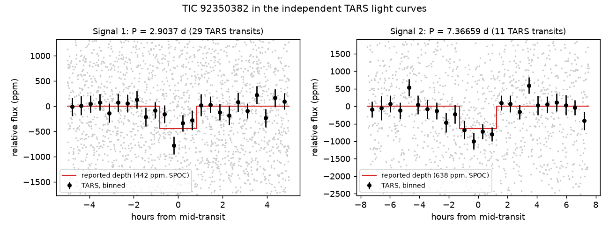

# TIC 92350382 (L 568-50): check of a community report

**Report:** [Planet Hunters TESS Talk, 2026-10-21](https://www.zooniverse.org/projects/nora-dot-eisner/planet-hunters-tess/talk/2110/4160105)
(RaymondSmith): signal 1, P = 2.90370 d, 442 ppm, 1.66 h (~1.3 Earth radii); signal 2, P = 7.36659 d, 638 ppm, 2.51 h.

**Checked 2026-10-21.**

- **Independent light curves.** In the TESS All-Sky Rotation Survey (TARS) light curves, which come from a separate
  reduction of the full-frame images, signal 1 stacks to 431 ± 88 ppm over 28 transits (3.0σ against stacks at random
  phases) and signal 2 to 887 ± 123 ppm over 11 transits (5.6σ). TARS keeps stellar variability, so with the star's
  ~9 d rotation the signal-2 number should be read with care.
- **Where the dip is.** A per-source depth map from TESScut cutouts puts signal 1 on the target, preferred by
  Δχ² ≈ 19 over every catalogued neighbour within 2.5′ (T < 15.9) and over no dip, mostly from Sector 68. The 44″
  neighbour is too faint for the map.
- **A Sector 1 artefact.** The ~1700 ppm "single dip" at BTJD 1342.82 (Sector 1, the 2018 volunteer note "near day 17")
  coincides with a sky-background rise of ~8.6% of the star's flux in the SPOC data and appears as a brightening in
  TARS, ELEANOR-LITE and TGLC: an over-subtracted background, not a transit.

**Blind search, 2026-10-25.** The development version of our search (KESTREL v2: uncapped period grid, revised
stopping rules, and a mask for sky-background excursions in the SPOC/TESS-SPOC data), run on Sectors 1, 27, 68 and 95
without being given a period, finds signal 1 as its top peak: P = 2.90371 d, SDE 12.2, 469 ppm, a dip at 24 of 25
transits with data, positive depth in every sector (S1 283 ± 94, S27 544 ± 88, S68 538 ± 89, S95 321 ± 83 ppm),
odd/even 1.2σ, no secondary. It passes all the search's checks; a transit fit agrees with the star's density (0.5σ),
the depth map again puts it on the target, and TRICERATOPS gives FPP 0.027 ± 0.002, NFPP < 0.0001. Signal 2 is the
second peak (7.36666 d, SDE 9.3, 636 ppm), flagged for an ambiguous period. The same two peaks come out with a
biweight detrending. The published version of our search (paper-v1) stopped on this star before testing it, because
the Sector 1 artefact above dominated its periodogram; the background mask is the fix.

`figure.py` makes the figure from the TARS files at MAST.
