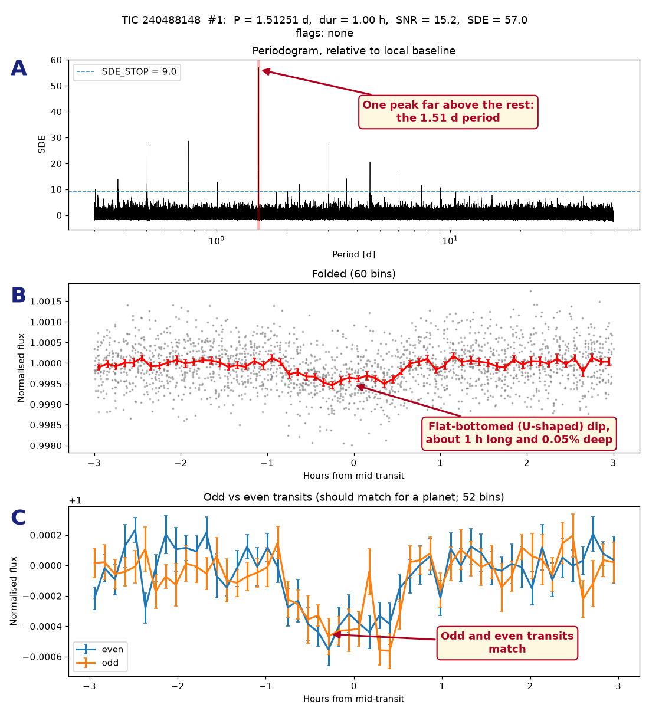
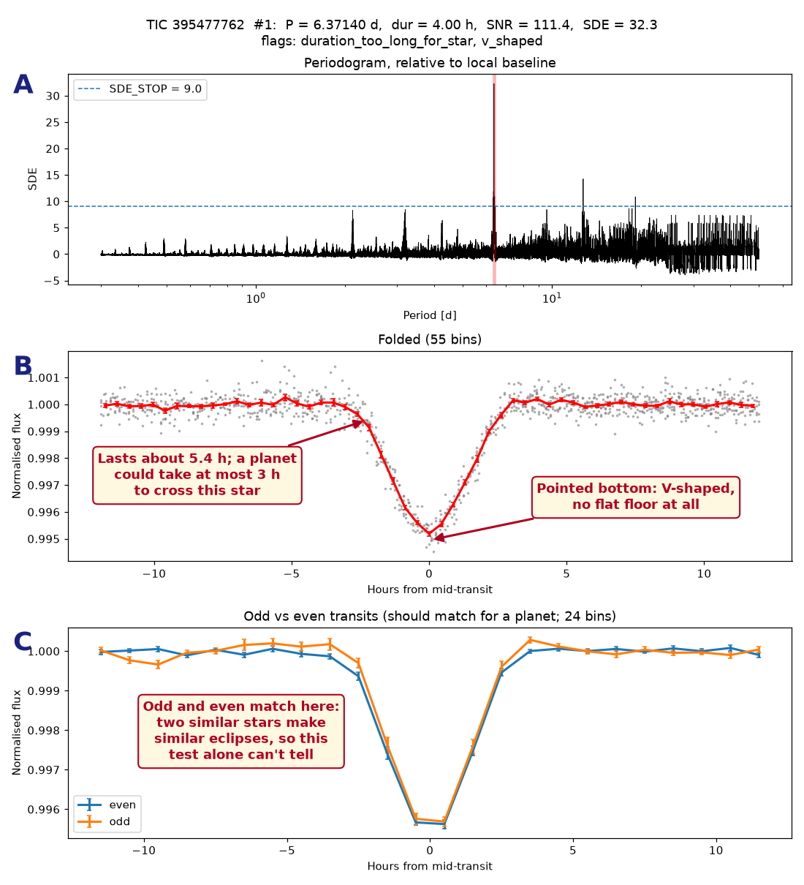
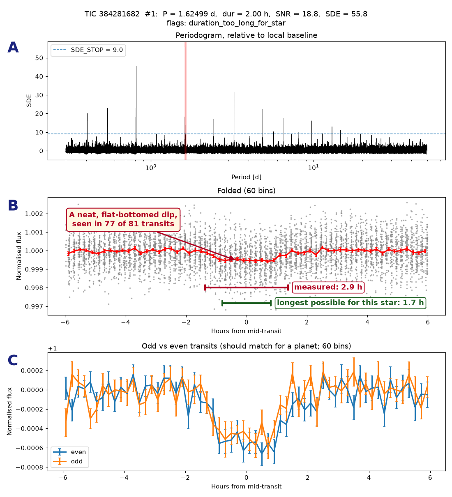
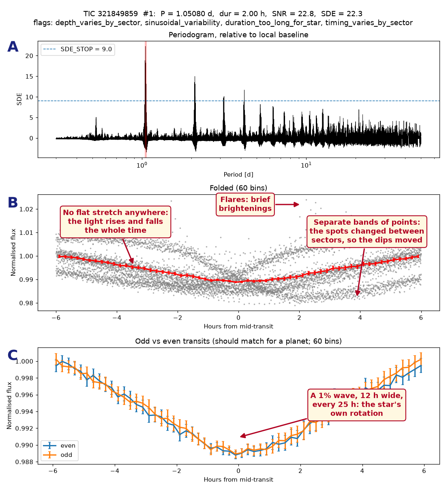
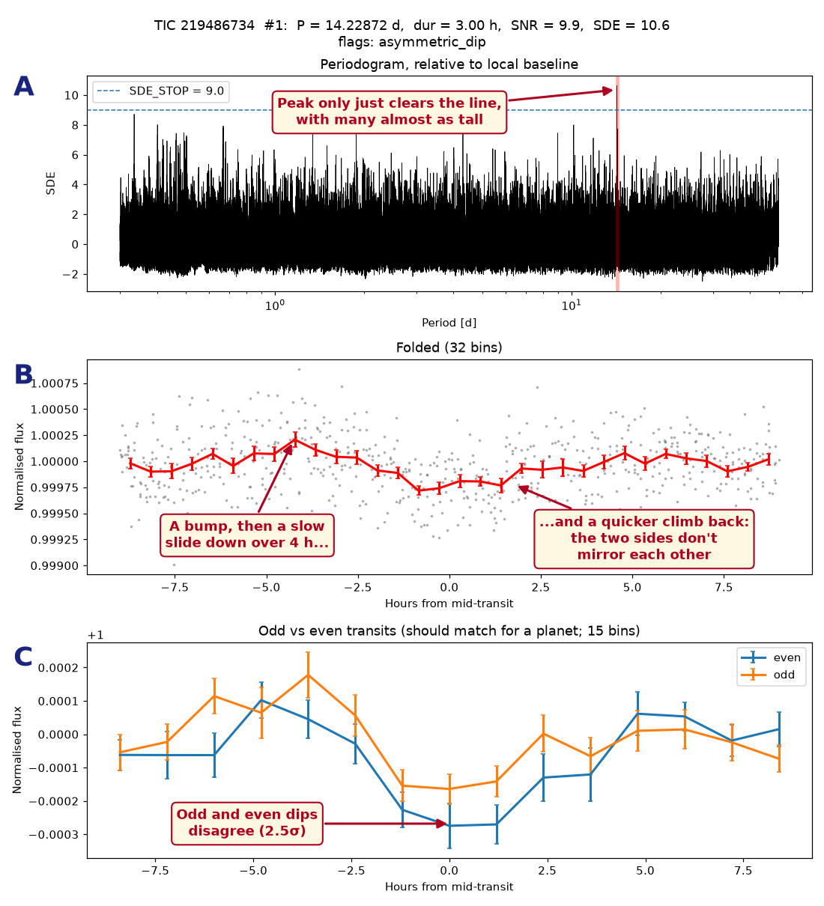
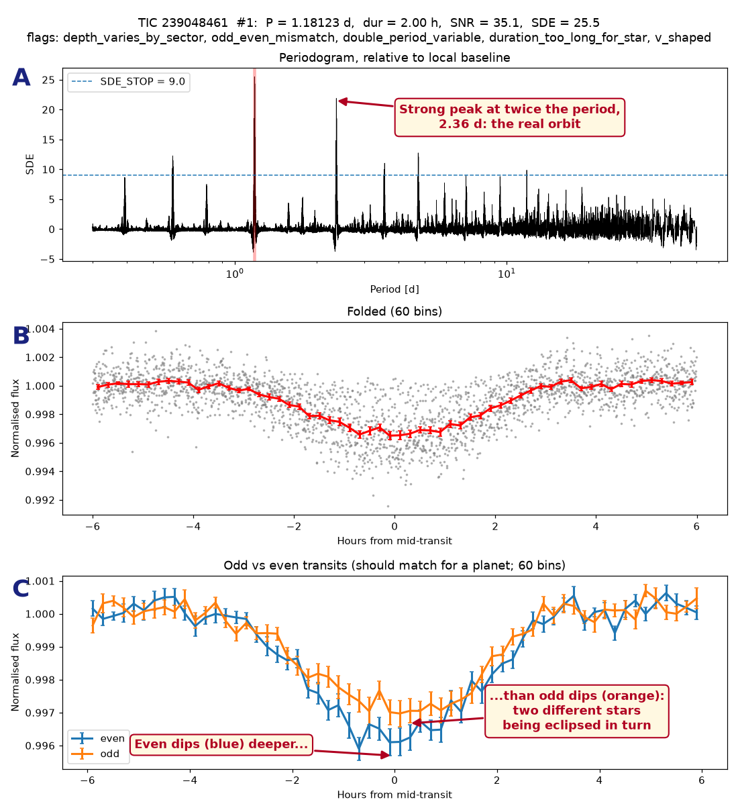
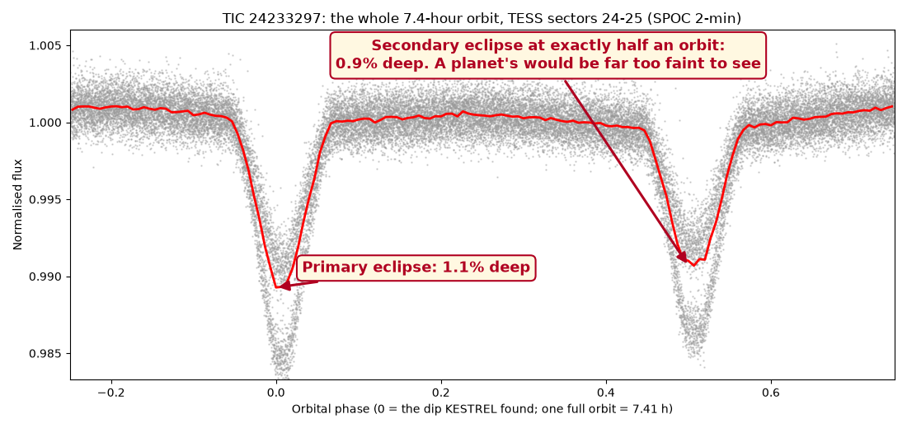
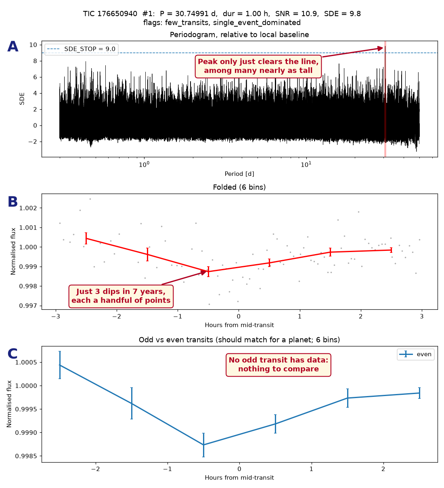
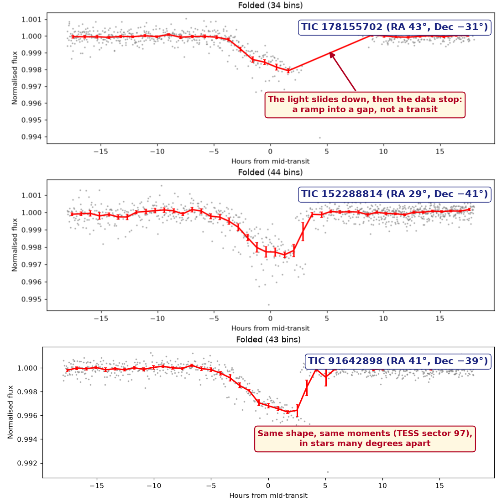
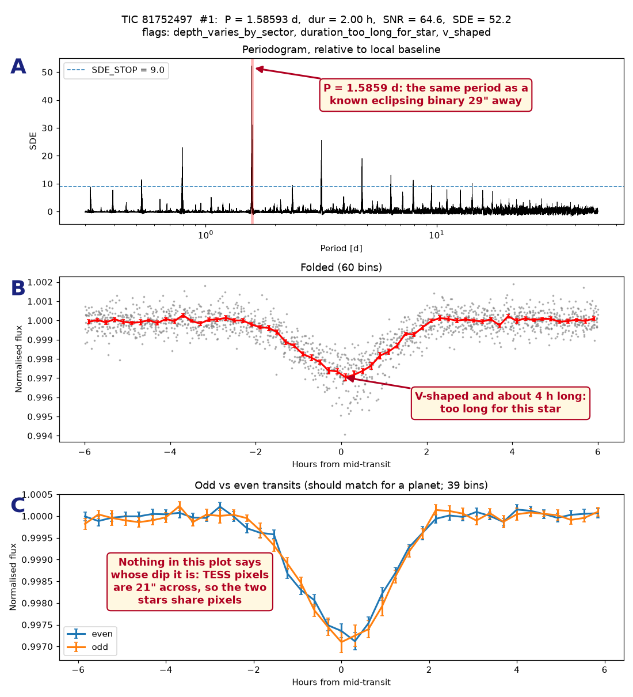

# Is it a planet? What I learned reading TESS transit plots

*Steve Price ([ORCID 0009-0004-6010-3869](https://orcid.org/0009-0004-6010-3869)), October 2026*

## Why I wrote this

When I started looking at TESS light curves, before I built KESTREL, I kept finding dips that looked like planets and turned out not to be. These are the lessons I learned along the way, each shown with a real example from my own search. I'm sharing them as a request for comments: corrections, better examples and checks I've missed are all welcome.

KESTREL is the automated transit search I've been running on bright K and M dwarfs. Of more than 1,000 repeating signals it found on over 12,000 stars, under 4% passed every automatic test for being a transit. The rest were real dips with other causes: two stars eclipsing each other, spots on a spinning star, a variable star next door, or quirks of the spacecraft. Many looked convincing at first glance. Below are nine of them, each beside the clue that gave it away.

I've written it for people who already look for dips in light curves but, like me when I started, might not know what a V-shaped dip means or how long a transit across a small star can last. Several lessons came from Planet Hunters TESS volunteers: orionlee suggested checking SPOC's TCE reports, and mkmyers45 pointed me to the Villanova TESS eclipsing binary catalogue.

**Contents:** [How to read the plots](#how-to-read-the-plots) · [What a real transit looks like](#what-a-real-transit-looks-like) · [1. U or V?](#lesson-1-u-or-v) · [2. Too long for its star](#lesson-2-a-transit-too-long-for-its-star) · [3. Starspots](#lesson-3-starspots-or-a-transit) · [4. Lopsided dips](#lesson-4-slow-variation-and-lopsided-dips) · [5. Eclipsing binaries](#lesson-5-two-stars-not-a-star-and-a-planet) · [6. Too few transits](#lesson-6-too-few-transits-to-be-sure) · [7. The spacecraft](#lesson-7-dips-made-by-the-spacecraft) · [8. A neighbour](#lesson-8-a-neighbours-eclipses) · [Checklist](#a-checklist-what-i-now-check)

## How to read the plots

Every KESTREL plot below has the same three panels. The title line gives the star, the period P, the transit duration, two measures of strength (SNR and SDE) and the flags KESTREL raised; "flags: none" means the signal passed every automatic test.

- **A, periodogram.** KESTREL tries up to 400,000 trial periods and scores how well a repeating box-shaped dip fits each one. A real signal makes one peak stand far above the rest. The smaller spikes are the same signal caught at half, double or a third of its true period.
- **B, folded light curve.** Every transit is stacked on top of the others, centred on mid-transit. Grey points are single measurements; the red line averages them. Folding is what lets a dip far shallower than the scatter of single points show up.
- **C, odd versus even.** Transits 1, 3, 5… (orange) and 2, 4, 6… (blue) are folded separately. A planet makes the same dip every time, so the two lines should match.

SNR is how many times the dip's depth exceeds the noise; KESTREL needs at least 7. SDE is how far the periodogram peak stands above the rest; it needs at least 9 (the dashed line in panel A).

## What a real transit looks like

The plot above is TIC 240488148, a K dwarf with a 1.51-day signal that passed every test; it was [posted to Planet Hunters TESS](https://www.zooniverse.org/projects/nora-dot-eisner/planet-hunters-tess/talk/2110/4154549) in October 2026. It is a candidate, not a confirmed planet, but it shows what a planet should look like. If real, the planet is about 1.5 times the size of Earth.

| Clue | What the plot shows | Why it fits a planet |
| --- | --- | --- |
| Shape | A flat-bottomed dip with sloping sides (U-shaped) | A small planet is fully in front of the star for most of the transit |
| Duration | 1.5 hours | The longest possible transit for this star at this period is 1.6 hours |
| Odd vs even | The two lines match (0.5σ apart) | A planet blocks the same light every time |
| Second dip at half phase | None (7 ± 30 ppm) | A planet gives off far too little light to show its own eclipse |
| Sector to sector | 385–452 ppm in all six sectors | The same planet blocks the same fraction of light in every sector |

The dip is only 0.04% deep, far smaller than the scatter of single points in panel B. That is normal for a small planet. The signal comes from stacking 76 transits, not from any one of them.

## Lesson 1: U or V?

A V-shaped dip with no flat bottom usually means two stars eclipsing each other, not a planet. TIC 395477762 shows a deep, clean dip every 6.37 days, seen in all seven transits with an SNR of 111. It looks like the strongest signal you could wish for.

A planet is far smaller than its star, so once it is fully in front of the star the light stays at one level until it starts to leave: a flat floor. When the eclipsing body is a star, comparable in size to the one behind it, the two are never fully overlapped for long, and the dip falls and rises in one movement: a V.

Two more clues agree. The dip lasts about 5.4 hours, but a planet on a 6.4-day orbit could take at most 3 hours to cross a star this size (Lesson 2). And the search found a second dip, 0.23% deep, exactly half an orbit later: the companion star being eclipsed in turn. Its odd and even dips match only because the two stars are similar.

A caution: a planet that only grazes the edge of its star also makes a V, so a V alone is a strong hint rather than proof. Here it comes with every other clue too.

## Lesson 2: a transit too long for its star

A dip that lasts longer than any planet could take to cross the star means something else is being eclipsed. TIC 384281682 has a neat 0.05% dip every 1.62 days, in 77 of its 81 transits, and failed only this one test. If you didn't know the star's size, it would pass for a planet.

A transit's length is set by the star's size and how fast the planet moves, and the period fixes the speed. On a 1.62-day orbit a planet races past: across this star (0.74 times the Sun's radius) it can take at most 1.7 hours. The dip lasts 2.9 hours. KESTREL flags anything over 1.5 times the limit.

So the body being crossed is bigger than the star we think we're looking at. Usually that means the dip comes from a larger star in the same pixels, such as a background eclipsing binary, whose deep eclipses are diluted to a shallow dip by our star's light. Less often the catalogue's size for the star is simply wrong.

A rough guide to the longest possible transit, for a planet crossing the middle of the star on a circular orbit:

| Period | Sun-like star | K dwarf (0.7 R☉) | M dwarf (0.4 R☉) |
| --- | --- | --- | --- |
| 1 day | 1.8 h | 1.4 h | 1.0 h |
| 3 days | 2.6 h | 2.1 h | 1.4 h |
| 10 days | 3.9 h | 3.1 h | 2.1 h |
| 30 days | 5.6 h | 4.4 h | 3.1 h |

Shorter is fine: a planet crossing near the edge of the star spends less time in front of it. Much longer is the warning.

## Lesson 3: starspots or a transit?

A spotted, spinning star dims and brightens smoothly once per rotation; a transit is a short dip in otherwise steady light. TIC 321849859 is the BY Draconis variable V0645 Lyr, an active K dwarf that turns once every 25 hours. A search for repeating dips finds its rotation at once, with a 1% "dip" every 1.05 days.

Dark spots cover part of the star's surface. As the star turns, the spotted side swings into view and the star looks fainter, then swings away again. Three things give it away:

- **No flat stretch.** Around a transit the light is steady and the dip is short. Here the light is always rising or falling; the "dip" fills the whole 12-hour window.
- **The pattern moves.** Spots grow, fade and drift over weeks, so each TESS sector shows a slightly different curve. Folded together they make separate bands of points instead of one tidy line. A planet's transits land in the same place every time.
- **Flares.** Active, spotted stars flare: sudden, brief brightenings that show up as stray points above the curve.

A transit is also far shorter than a rotation: on a 1-day orbit around this star a planet's transit would last under 1.5 hours. If the "dip" takes up a large fraction of the period, think rotation first.

## Lesson 4: slow variation and lopsided dips

A transit's two sides mirror each other; a dip that slides down slowly and climbs back quickly is more likely left over from the star's slow changes. TIC 219486734 shows a 0.02% dip every 14.2 days, in all six transits across three sectors, at a size that would make a planet only 1.3 times Earth's. Small, shallow, consistent: exactly what searches hope for.

Stars brighten and fade slowly over hours and days, and TESS adds slow drifts of its own. Before searching, KESTREL removes these by fitting a smooth curve and dividing it out. The removal is never perfect, and the leftovers are shallow, broad wiggles. Now and then a few of them line up at some period and look like a transit.

The clues are in the shape. A planet enters and leaves the star's disc at the same speed, so the way down and the way up are mirror images. Here the light rises into a bump, slides down over about four hours, and climbs back in under one. The periodogram peak only just clears the threshold, with dozens of others nearly as tall, and the odd and even dips disagree.

None of this proves the dip is false, and more sectors will settle it. But a shallow dip that is lopsided, with a weak periodogram peak, is far more often noise than a planet.

## Lesson 5: two stars, not a star and a planet

In an eclipsing binary each star takes a turn in front of the other, so you see two dips per orbit; a planet gives one. The two clues are alternating dip depths and a second dip at half phase. Both examples below look like transits on their own target star, but each is a binary sitting 47–88 arcseconds away whose light leaks into the target's pixels (Lesson 8).

### Odd and even dips differ

TIC 239048461 shows a 0.35% dip every 1.18 days, 48 times. Split into odd and even dips, the even ones are about 0.39% deep and the odd ones 0.30%: a 6.8σ difference. That is two different stars being eclipsed in turn, so the real orbit is twice as long, 2.36 days, and the periodogram has a strong peak there too. A known eclipsing binary 88 arcseconds away, ASASSN-V J053655.03+370452.9, has exactly that period.

When two stars are alike, the dips can be equal, and the search sees one star's eclipses every half orbit. Then the second clue helps.

### A second dip at half phase

This is a whole orbit of TIC 24233297, folded over 7.4 hours instead of a few hours around the dip. There is a 1.1% dip at phase 0 and a 0.9% dip exactly half an orbit later. A planet also passes behind its star, but it gives off so little light that its eclipse is under 0.1% even for the hottest giant planets, and far less for a small one. A 0.9% second dip means the companion shines nearly as brightly as the star it eclipses. The source is the contact binary HAT-192-0001841, 47 arcseconds away.

KESTREL's own plots show only a few hours around the dip, so it checks for a second dip separately. When you look at a light curve yourself, always fold it over the whole orbit.

## Lesson 6: too few transits to be sure

A signal built from a handful of dips is unproven: each dip carries too much of the weight. TIC 176650940 shows a 0.1% dip every 30.75 days, seen each time it was due, and clears both of KESTREL's thresholds. But in five TESS sectors spread over seven years, the dip fell in the data only three times.

Three things make a few-transit signal fragile:

- **One dip can carry it.** Without its strongest dip, this signal's SNR falls from 10.9 to 6.7, below the threshold of 7. A single dip from a flare, a spacecraft glitch or plain noise can then be most of the evidence. With 76 transits, as in TIC 240488148, one bad dip hardly counts.
- **The period may be wrong.** TESS watches each patch of sky for about 27 days at a time, with gaps of a year or more between. Three dips years apart fit many periods, and the search can only pick the one that fits best.
- **Checks run out.** All three dips fall on even-numbered transits, so panel C has no odd half to compare, and there are too few points to judge the shape.

KESTREL requires at least five transits before calling a signal clean. A signal like this one is a reason to look again when TESS returns to the star, not a discovery.

## Lesson 7: dips made by the spacecraft

If the same "transit" appears at the same moments in stars far apart on the sky, the spacecraft made it. KESTREL found dips of 0.06–0.3% with a period of about 13.3 days on 17 different stars, spread over tens of degrees of the southern sky. Each one alone looks like a sizeable planet.

In 15 of the 17, the dips come from the same stretch of data, TESS sector 97, and fall at the same times. No planet can orbit 15 unrelated stars in step, so the cause is in the data. TESS circles the Earth roughly every two weeks and pauses at each close approach to send its data home. Around those breaks the pointing, temperature and scattered sunlight change, and the light curves of many stars sag or ramp together.

The plots carry clues too:

- **The dip runs into a gap.** In the top panel the light slides down for five hours and then the data stop; the "recovery" is just a straight line drawn across the gap. A transit has data on both sides.
- **The shape is wrong.** The decline is slow and the recovery abrupt, and all three last about six hours, longer than a planet could take to cross these stars.
- **Every dip comes from one sector.** Each of the three shown rests on three dips, all in sector 97.

If you find a dip, check whether it falls next to a gap in the data, and whether other stars observed in the same sector dip at the same time.

## Lesson 8: a neighbour's eclipses

A dip in your star's light curve may belong to a different star nearby. TESS pixels are 21 arcseconds across, and the light of a star spreads over several of them, so every TESS light curve includes some light from the neighbours. TIC 81752497 shows a strong 0.2–0.3% dip every 1.586 days.

The period gives it away. A star 29 arcseconds away, about 1.7 magnitudes fainter, is a known eclipsing binary with a period of 1.58594 days; ours is 1.58593. That star's eclipses need only be about 2% deep to make a 0.2% dip once its light is mixed with our brighter star's.

The depth changes with how the light was collected, which is the second clue:

| Sector | Light curve | Dip depth |
| --- | --- | --- |
| 18 | TESS-SPOC, 30-minute | 0.25% |
| 19 | TESS-SPOC, 30-minute | 0.21% |
| 59 | TESS-SPOC, 200-second | 0.18% |
| 86 | QLP, 200-second | 0.33% |

Each light curve sums the pixels in a different patch (its aperture), so each includes a different share of the neighbour's light. A planet's transit would be the same depth in all of them.

The search can also catch a neighbour at a related period. On TIC 39389004 it found a dip every 0.416 days, exactly 1.5 times the 0.277-day period of a contact binary 50 arcseconds away.

To settle whose dip it is, KESTREL measures the depth in each pixel separately and asks which star sits where the dimming is strongest. You can make the first check yourself: look up the stars within a couple of arcminutes in VSX or Gaia and compare their periods with yours, including half and double.

## A checklist: what I now check

These are the checks I now run before getting excited about a dip. A real planet candidate should pass all of them; failing one usually means one of the lessons above.

- [ ] **Shape:** flat-bottomed (U), not pointed (V). *Lesson 1*
- [ ] **Duration:** no longer than the star allows at this period (see the table in Lesson 2). *Lesson 2*
- [ ] **Steady light around the dip:** the light is level before and after, and the dip is a small fraction of the period. *Lessons 3 and 4*
- [ ] **Symmetry:** the way down mirrors the way up. *Lesson 4*
- [ ] **Odd vs even:** alternate dips have the same depth. *Lesson 5*
- [ ] **No second dip at half phase:** fold over the whole orbit, not just around the dip. *Lesson 5*
- [ ] **Enough transits:** at least five, and the signal survives without its strongest one. *Lesson 6*
- [ ] **Data on both sides:** the dips don't sit at the edge of a data gap, and they don't all come from one sector. *Lesson 7*
- [ ] **Same depth everywhere:** each sector and each pipeline gives about the same depth. *Lesson 8*
- [ ] **No neighbour with the same period:** check VSX and Gaia within a couple of arcminutes, at the period, half and double. *Lesson 8*
- [ ] **Not already known:** search ExoFOP for the star's TOIs and community TOIs, and ExoMAST for SPOC detections (TCEs).

Passing every check makes a dip a candidate, not a planet. Confirming it still takes higher-resolution imaging to rule out close companions, and usually measurements of the star's wobble to weigh the planet.

---

All plots are from KESTREL's searches of public TESS data (SPOC, TESS-SPOC and QLP light curves from MAST), except the whole-orbit fold in Lesson 5, made from TIC 24233297's SPOC light curves for sectors 24 and 25. KESTREL's code was written with the help of an AI coding assistant (Claude, by Anthropic), which also helped draft this write-up; the searches, examples and checks are from my own runs.
